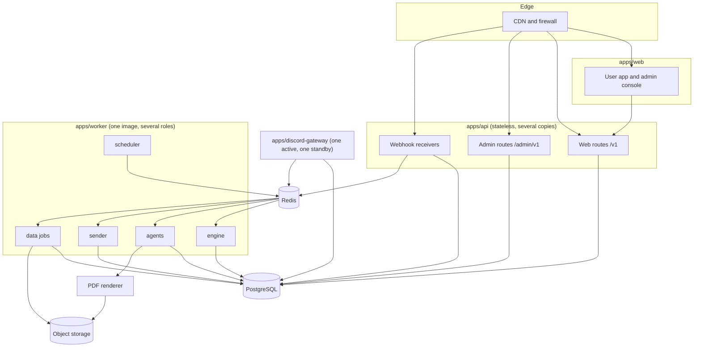
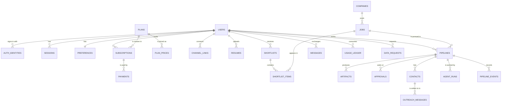

# JobsQ — Backend design

> **What is built today** is in [CURRENT_BUILD.md](CURRENT_BUILD.md). This document describes the V1 target; parts not listed there are planned. Updated 2026-11-25 for the new plans, resume timing and order of work.

Status: Draft v0.4 (2026-11-25). Not approved. This is the input for the System Design (template C7) and Data Model (template C8); it goes through design review, as the TrunkQ framework requires. A first build already exists ([CURRENT_BUILD.md](CURRENT_BUILD.md)).

Read [WORKFLOW.md](WORKFLOW.md) first for the picture. This document is the detail: services, database, API, queues, the agent runtime, channels, billing, security and operations.

Technology named here is a **proposal** carried over from archive/PLAN.md. The CTO decides the stack and the AI vendor; section 25 lists every such decision.

> **Changes of 18 November 2026** ([DECISIONS_2026-11-18.md](archive/DECISIONS_2026-11-18.md)). Where an older passage below disagrees with this box, this box wins.
>
> | Area | Change in this document |
> |---|---|
> | Sign-in | Email and **password** (hashed with Argon2id). Reset and email verification by emailed link. Google sign-in and email codes are open, not decided. Phone number collected at registration |
> | Interfaces | **Three adapters** on one engine: WhatsApp, Discord and the **web app**, which has full parity. A **mobile app** is planned on the same API |
> | Channels | The user chooses WhatsApp or Discord **once. No switching.** Reconnecting the same channel is allowed. The `channel_links` unique index covers the user for good |
> | Plans | **Two plans:** JobsQ AI (`jobsq_ai`, JobsQ pays for the AI) and Your own AI (`own_ai`, the user's Claude Code or Codex subscription through the JobsQ Connector). Tables `connectors`, `ai_tasks`, `house_connector` |
> | Limits | Daily application limit (5 or 10) and an active-jobs limit, as plan defaults with a **per-user override table** set by the super admin. Monthly application limits are withdrawn |
> | Resume | Read with pdfplumber and python-docx, **no AI call**, saved before payment; the AI reads it when the plan starts |
> | Prompts | "Did you apply?" 2 hours after resume approval; "Did you get a reply?" 4 days after Yes, repeated for 30 days; working values, limits open |
> | Deletion | **No self-service delete in V1.** The deletion routes and `confirm_delete` code purpose are postponed; erasure on request is a manual procedure (see the second box) |
> | Models | The build uses Claude (`claude-opus-5-5` by default). Section 13.3 is a working basis for cost only |
> | Language | **Decided 18 Nov 2026 (D30): backend Python 3.12 with FastAPI; frontend Next.js (React) with TypeScript** (reasons in [RECOMMENDATIONS §2](archive/RECOMMENDATIONS_2026-11-18.md#2-backend-language-python-312-with-fastapi-recommended)). The mobile app (React Native with Expo) is recommended, not decided. **Code samples below use TypeScript notation for shapes only**; in code they are Pydantic models and Python protocols. File names are the Python ones |
> | Currency, payment provider | **Open** |
>
> **Changes of 18 November 2026, second message** ([DECISIONS_2026-11-18.md](archive/DECISIONS_2026-11-18.md) D23–D29).
>
> | Area | Change in this document |
> |---|---|
> | Growth | **India first, global later.** `users.country`; currency and tax per country; translatable text; room for a second hosting region. Nothing global is built in V1 |
> | Scale | **Production ready for 100 to 1,000 users at once.** Section 20.4 holds the targets and the pre-launch tests |
> | One history | `messages` is **one timeline per user** with a `surface` (web, whatsapp, discord) and a per-user order; answers are saved with a compare-and-set on the item's version; first answer wins. Section 12.5 |
> | Copy button | Email and LinkedIn drafts are delivered with a copy button: real in the web app; on WhatsApp and Discord a text-only message (`copyable`) plus a "send as plain text" action. Section 15.1 |
> | Formats | The tailored resume is delivered as **PDF and Word** (section 17) |
> | Erasure | Everything personal is erased on request **except the activity log and the payment invoices and receipts, linked by user ID**. New table `activity_log`; `data_requests.kind` includes `erase`. The self-service button is later; the super admin runs a procedure at launch. Sections 8.8, 8.11, 9.6 |
> | Prompts | Must (limits open) |
> | Open | The user's LinkedIn ID (a nullable `users.linkedin_id`, only if the product owner decides to collect it). The daily limit and the model are **crucial cost decisions** |

**Contents:** [1 Principles](#1-principles) · [2 Architecture](#2-architecture) · [3 Processes](#3-processes) · [4 Repository layout](#4-repository-layout) · [5 Technology](#5-technology-proposal) · [6 Environments and configuration](#6-environments-and-configuration) · [7 Identity and access](#7-identity-and-access) · [8 Data model](#8-data-model) · [9 HTTP API](#9-http-api) · [10 Queues and background work](#10-queues-and-background-work) · [11 Inbound message lifecycle](#11-inbound-message-lifecycle) · [12 Conversation engine](#12-conversation-engine) · [13 Agent runtime](#13-agent-runtime) · [14 Tool layer](#14-tool-layer) · [15 Channel layer](#15-channel-layer) · [16 Billing and entitlements](#16-billing-and-entitlements) · [17 Files and PDF rendering](#17-files-and-pdf-rendering) · [18 Security and privacy](#18-security-and-privacy) · [19 Observability](#19-observability) · [20 Reliability and scale](#20-reliability-and-scale) · [21 Testing and evals](#21-testing-and-evals) · [22 Deployment](#22-deployment) · [23 Cost](#23-cost) · [24 Build order](#24-build-order) · [25 Open decisions](#25-open-decisions-for-the-cto) · [26 Alternatives considered](#26-alternatives-considered)

---

## 1. Principles

1. **Code decides the flow; the model writes the words.** Which step runs next, who may do what and when to stop are decided by ordinary code and database state. A model is called inside a step to search, summarise or draft. No model decides which agent speaks next.
2. **Nothing advances without the user.** Each approval is a database row. A pipeline cannot leave a review state except through a recorded user decision.
3. **Agents have no hands.** No shell, no file system, no browser, no ability to send a message or spend money. Every capability is a typed server-side tool with limits.
4. **The user id never comes from the model.** Tools take the user from the server's job context. A prompt injection cannot ask for someone else's data, because there is no parameter to ask with.
5. **Truthfulness is checked in code.** Resume and draft facts must trace to the user's uploaded resume or to stored research. A failed check blocks the output.
6. **Every external call is safe to repeat.** Webhooks, queue jobs and button taps can arrive twice; each has an idempotency key.
7. **One engine, three adapters.** Agents return a channel-neutral message. Only the adapters (WhatsApp, Discord, web app) know where it is going.
8. **Measure cost from the first line.** Every model call, search, lookup, message and render writes a cost row.
9. **Derived values are computed, not stored.** Access level, usage totals and "follow-up due" are queries over facts, so they cannot drift.

---

## 2. Architecture



External services (Meta, Discord, the payment provider, the Claude API, job search, web search, email lookup, email sending) are shown in [WORKFLOW.md §2](WORKFLOW.md#2-system-map).

---

## 3. Processes

| Process | What it does | Scales on | State |
|---|---|---|---|
| `web` | Serves the user app and the admin console | Requests | None |
| `api` | Web and admin routes; receives webhooks from Meta, Discord and the payment provider; verifies, stores, queues | Requests | None |
| `worker --role=engine` | Conversation engine: reads a user's pending events in order, decides the next step | Inbound queue depth | None (state is in PostgreSQL) |
| `worker --role=agents` | Runs agent steps: model calls and tools | Agent queue depth, bounded by model rate limits | None |
| `worker --role=sender` | Delivers outbound messages to WhatsApp and Discord within rate limits | Outbound queue depth | None |
| `worker --role=scheduler` | Fires timed jobs | Single active copy | None |
| `worker --role=data` | Exports, deletions, purges | Queue depth | None |
| `discord-gateway` | Holds the Discord WebSocket; turns direct messages into inbound events | One active copy, one standby | Session id and sequence number in Redis |
| `renderer` | Turns resume HTML into a one-page PDF and Word file | Render queue depth | None |

Every process except the gateway is stateless and can be killed and restarted at any time.

---

## 4. Repository layout

One repository: Python packages in one workspace (uv or Poetry) and the Next.js web app (pnpm).

```
apps/
  web/               Next.js (TypeScript): user app, workspace and admin console
  api/               FastAPI: HTTP API and webhook receivers
  worker/            Python: engine, agents, sender, scheduler, data jobs (role chosen at start)
  discord-gateway/   Python: Discord WebSocket listener
  renderer/          PDF render service (or a stock Gotenberg container)
packages/            Python packages in one workspace
  db/                schema, migrations, row-level-security policies, typed queries
  core/              domain logic: access rules, pipeline state machine, entitlements
  engine/            intent resolution, routing, approvals, message catalogue
  agents/            one folder per agent: prompt, output schema (Pydantic), tool list, evals
  tools/             server-side tools the agents may call
  llm/               thin wrapper over the model API: routing, caching, cost capture
  channels/          channel-neutral message model + WhatsApp, Discord and web adapters
  billing/           provider interface + payment provider adapters
  shared/            Pydantic models, validation, error codes (the OpenAPI description comes from these)
web-packages/
  api-client/        TypeScript client generated from the OpenAPI description
tools/
  simulator/         fake WhatsApp and Discord for local work and CI
  md-to-pdf.mjs      (exists) renders docs to PDF
docs/
  design/            approved design documents (framework rule)
CLAUDE.md            conventions for Claude Code sessions (framework rule)
```

`packages/core` and `packages/engine` have no network or database imports of their own; they take interfaces. That keeps the state machine testable without infrastructure.

---

## 5. Technology (proposal)

| Layer | Proposal | Reason |
|---|---|---|
| Language (backend) | **Decided: Python 3.12 with FastAPI** | pdfplumber and python-docx are Python; python-docx also writes the Word resume; async fits the long waits on AI and job APIs; OpenAPI contract for the web and mobile apps; Pydantic for the output schemas. CPU-heavy parts (reading files, rendering) run in worker processes, not the API. Full reasoning: [RECOMMENDATIONS §2](archive/RECOMMENDATIONS_2026-11-18.md#2-backend-language-python-312-with-fastapi-recommended) |
| Web (frontend) | **Decided: Next.js (React) with TypeScript**, Tailwind | Server-rendered public pages; interactive workspace; live updates by server-sent events; typed client generated from the OpenAPI description |
| Mobile (planned) | **React Native with Expo** | Same language and generated client as the web app; iOS and Android |
| API | FastAPI | Small, fast, easy to run as many identical copies |
| Database | PostgreSQL (managed) with row-level security | One store for everything relational, including the per-user ordered mailbox |
| Queue and cache | Redis with Arq or Celery | Enough for millions of jobs a day; also holds rate limits and locks |
| Files | S3-compatible object storage, encrypted | Resumes are sensitive |
| PDF and Word | PDF by Gotenberg or a Puppeteer pool, in its own container; Word by python-docx | Chromium is heavy and must be isolated; the tailored resume is delivered in both formats |
| Models | **Open.** Claude prices are the working basis | See section 13 |
| Email | A transactional email service (for example Amazon SES, Postmark or Resend) | Verification and password-reset links, and billing notices |
| Hosting | Web on Vercel (already used at TrunkQ); API, workers, gateway and renderer as containers; a region near India first, another can be added later | Decision for the CTO |
| Infrastructure as code | Terraform | Repeatable environments |
| Errors and traces | Sentry plus OpenTelemetry to a metrics backend | Section 19 |

---

## 6. Environments and configuration

| Environment | Purpose | Data | Channels | Payments |
|---|---|---|---|---|
| `local` | A developer's machine | Seed data | Simulator | Stubbed |
| `dev` | Shared integration | Synthetic | Meta test number, a test Discord app | Provider test mode |
| `staging` | Release rehearsal and QA | Synthetic | Meta test number or a second real number, staging Discord app | Provider test mode |
| `prod` | Real users | Real | Production number, production Discord app | Live |

Configuration comes from environment variables, loaded and validated at start; a process refuses to start if one is missing. Names only (values live in the secret manager):

```
APP_ENV  WEB_BASE_URL  API_BASE_URL  ADMIN_BASE_URL
DATABASE_URL  DATABASE_URL_ADMIN  REDIS_URL
STORAGE_BUCKET  STORAGE_REGION  KMS_KEY_ID
SESSION_COOKIE_SECRET
PASSWORD_PEPPER
GOOGLE_OIDC_CLIENT_ID  GOOGLE_OIDC_CLIENT_SECRET   (only if Google sign-in is chosen)
EMAIL_API_KEY  EMAIL_FROM
ANTHROPIC_API_KEY  AI_MODEL   (JobsQ AI plan only)
WHATSAPP_APP_SECRET  WHATSAPP_VERIFY_TOKEN  WHATSAPP_ACCESS_TOKEN
WHATSAPP_PHONE_NUMBER_ID  WHATSAPP_BUSINESS_ACCOUNT_ID
DISCORD_APPLICATION_ID  DISCORD_PUBLIC_KEY  DISCORD_BOT_TOKEN  DISCORD_CLIENT_SECRET
STRIPE_SECRET_KEY  STRIPE_WEBHOOK_SECRET
RAZORPAY_KEY_ID  RAZORPAY_KEY_SECRET  RAZORPAY_WEBHOOK_SECRET
JOB_SEARCH_A_KEY  JOB_SEARCH_B_KEY  WEB_SEARCH_KEY  EMAIL_LOOKUP_KEY
SENTRY_DSN  OTEL_EXPORTER_ENDPOINT
```

Rules: production secrets exist only in the production secret manager. They are never on a developer machine and never visible to a Claude Code session (framework guardrail). A deploy check fails if a production variable holds a free-tier or test key.

---

## 7. Identity and access

### 7.1 Users

- **Sign-in:** email and password. The password is stored only as an Argon2id hash with a per-user salt and a server-side pepper. Reset and email verification by emailed link (hashed tokens, single use). Login is rate-limited and locks after repeated failures. Google sign-in is open.
- **One person, one account:** one email and one phone number per user.
- **Sessions:** a random token in an `HttpOnly`, `Secure`, `SameSite=Lax` cookie; only its hash is stored. Rolling 30-day expiry. State-changing requests also carry a CSRF token.
- Detail: [features/01-registration-and-login.md](features/01-registration-and-login.md).

### 7.2 Access level (computed on every request and every inbound message)

```
suspended         user.status = 'suspended'
full              user.status = 'active'
                  AND a subscription exists with status in ('active','past_due')
                  AND now() < access_until
limited           everything else (registered-unpaid, lapsed, refunded)

access_until = greatest(current_period_end, grace_until, extended_until)
```

| Level | Web | Agents in chat |
|---|---|---|
| `full` | Everything | On |
| `limited` | Resume, plans, billing, export; past jobs read-only | Off: one reply linking to the plans page |
| `suspended` | Suspension notice, billing, export | Off: one reply saying the account is suspended |

On Your own AI, the agents also need the connector to be running; without it they are off and the user is told (access level stays `full`).

### 7.3 Admins

Admins are a separate table and a separate sign-in (company single sign-on, restricted to the company domain, with two-factor authentication). They never share a session with a user account. Roles: `support` and `super_admin`. Every admin route writes an audit row. Detail: [features/11-admin-console.md](features/11-admin-console.md).

### 7.4 Database roles

| Role | Used by | Sees |
|---|---|---|
| `app_user` | API for a logged-in user; workers acting for one user | Only rows where `user_id` equals the id set for the transaction |
| `app_system` | Webhook receivers before the user is known, scheduler, data jobs | Narrow set of tables through security-definer functions |
| `app_admin` | Admin API | Account, billing, usage and audit tables; content tables only with a valid support-access grant |
| `migrator` | Deploy pipeline | Schema changes only |

The user id is set with `SET LOCAL app.user_id = '…'` inside each transaction, so it works with a connection pooler in transaction mode.

---

## 8. Data model

### 8.1 Conventions

- PostgreSQL, `snake_case`, plural table names (template C8).
- Every table has `id uuid` (generated), `created_at` and, where rows change, `updated_at`.
- **`user_id` is JobsQ's tenant key.** It plays the role of `tenant_id` in the framework template: one user is one tenant. Every table that holds a user's data has it, and row-level security enforces it.
- Global tables (`companies`, shared rows of `jobs`, caches, `plans`, `feature_flags`) hold no user data.
- Status columns are text with a check constraint, listed in the comments below.
- Columns marked `enc` are encrypted in the application before they are written (section 18.2).
- The sketches below are the design, not the final migrations.

### 8.2 Relationships



### 8.3 Identity

```sql
users (
  id uuid pk,
  email citext unique not null,
  email_verified_at timestamptz,
  phone text unique not null,        -- E.164; verified when WhatsApp is chosen
  password_hash text not null,       -- Argon2id; never logged
  name text,
  country char(2),                   -- from the phone prefix until collected; drives currency and tax later
  linkedin_id text,                  -- OPEN: only if the product owner decides to collect it; erased on request
  timezone text,                     -- IANA name
  locale text default 'en',
  status text not null,              -- active | suspended   (self-service delete comes later; erasure on request is a procedure)
  resume_confirmed_at timestamptz,
  chosen_channel text,               -- whatsapp | discord | null; set once, never changed
  next_job_seq int not null default 1,
  created_at, updated_at
)

email_tokens (                      -- verification and password reset links
  id uuid pk, user_id fk,
  purpose text,                      -- verify_email | reset_password
  token_hash text, expires_at timestamptz,
  consumed_at timestamptz, requested_ip inet, created_at
)

login_attempts (
  id uuid pk, user_id fk null, email_hash text, ip inet,
  succeeded boolean, created_at          -- for lock-out and alerts; no passwords
)

sessions (
  id uuid pk, user_id fk, token_hash text unique,
  created_at, last_seen_at, expires_at, revoked_at,
  ip inet, user_agent text
)

consents (
  id uuid pk, user_id fk,
  kind text,                         -- terms | privacy | whatsapp_opt_in
  version text, source text,         -- web | whatsapp | discord
  granted_at timestamptz, withdrawn_at timestamptz
)

preferences (
  user_id uuid pk fk,
  roles text[], skills text[],
  locations jsonb,                   -- [{city, country}]
  work_modes text[],                 -- remote | hybrid | onsite
  experience_years numeric,
  industries text[],
  min_salary_amount int, min_salary_currency char(3), min_salary_period text,  -- year | month
  excluded_companies text[],
  include_internships boolean default false,
  digest_enabled boolean default false, digest_time time,
  updated_at
)
```

### 8.4 Billing and usage

```sql
plans (
  id uuid pk, code text unique,      -- jobsq_ai | own_ai
  name text, limits jsonb,           -- see features/03-usage-limits.md
  sort_order int, active boolean, created_at
)

user_limit_overrides (               -- set by a super admin; wins over plans.limits
  user_id fk, limit_key text,        -- application_per_day | active_jobs | prep_session ...
  value int, reason text, set_by fk, set_at timestamptz,
  primary key (user_id, limit_key)
)

connectors (                         -- Your own AI only
  user_id fk primary key, key_hash text unique,
  tool text,                         -- claude | codex
  last_seen_at timestamptz, created_at
)

ai_tasks (                           -- AI work waiting for a connector
  id pk, owner_user_id fk null,      -- null = JobsQ's own connector (development)
  agent text, system text, prompt text, web boolean,
  status text, result text, error text, usage jsonb, created_at, claimed_at, finished_at
)

plan_prices (
  id uuid pk, plan_id fk,
  provider text,                     -- stripe | razorpay
  provider_price_id text,
  currency char(3), interval text,   -- month | year
  amount_minor int, countries char(2)[], active boolean
)

billing_customers (
  id uuid pk, user_id fk, provider text, provider_customer_id text,
  unique (provider, provider_customer_id)
)

subscriptions (
  id uuid pk, user_id fk, plan_id fk, plan_price_id fk,
  provider text, provider_subscription_id text unique,
  status text,                       -- incomplete | active | past_due | canceled | refunded
  current_period_start timestamptz, current_period_end timestamptz,
  cancel_at_period_end boolean default false,
  grace_until timestamptz, extended_until timestamptz,
  first_paid_at timestamptz, canceled_at timestamptz, ended_at timestamptz,
  created_at, updated_at
)
-- unique index on (user_id) where status in ('active','past_due')

payments (
  id uuid pk, user_id fk, subscription_id fk,
  provider text, provider_payment_id text unique,
  amount_minor int, currency char(3),
  status text,                       -- succeeded | failed | refunded | partially_refunded
  paid_at timestamptz, refunded_amount_minor int, refunded_at timestamptz,
  invoice_url text, created_at
)

billing_events (
  id uuid pk, provider text, provider_event_id text,
  type text, payload jsonb,
  received_at timestamptz, processed_at timestamptz, error text,
  unique (provider, provider_event_id)
)

usage_ledger (                       -- append-only; the sum is the usage
  id uuid pk, user_id fk,
  unit text,                         -- application | shortlist | prep_session | revision
  delta int,                         -- +1 reserve, -1 release
  reason text,                       -- reserve | release | admin_adjust
  ref_type text, ref_id uuid,
  period_key date,                   -- billing period start, or the day for daily limits
  created_at
)
-- index (user_id, unit, period_key)

cost_events (                        -- append-only, partitioned by month
  id uuid pk, user_id uuid, agent_run_id uuid,
  kind text,                         -- llm | job_search | web_search | contact_lookup | whatsapp_message | pdf_render | email
  provider text, model text, units numeric,
  input_tokens int, output_tokens int, cache_read_tokens int, cache_write_tokens int,
  cost_micro_usd bigint, created_at
)
```

### 8.5 Channels and conversation

```sql
channel_links (
  id uuid pk, user_id fk,
  channel text,                      -- whatsapp | discord
  external_user_id text,             -- WhatsApp id, or Discord user id
  display_handle text,               -- masked number or Discord username, for the web app
  dm_channel_id text,                -- Discord only
  status text,                       -- active | disconnected | opted_out | unreachable
  linked_at timestamptz, disconnected_at timestamptz,
  last_inbound_at timestamptz,
  window_expires_at timestamptz,     -- WhatsApp only: last_inbound_at + 24 h
  failure_count int default 0,
  created_at, updated_at
)
-- unique index on (user_id) where status = 'active'
-- unique index on (channel, external_user_id) where status in ('active','opted_out','unreachable')

channel_link_codes (
  id uuid pk, user_id fk, channel text,
  code_hash text unique, expires_at timestamptz, used_at timestamptz, created_at
)

inbound_events (                     -- the per-user ordered mailbox
  id bigserial pk,
  channel text, external_event_id text,
  external_user_id text, user_id uuid,
  kind text,                         -- text | button | list_reply | select | command | modal | file | status
  payload jsonb,                     -- enc
  reply_to_external_id text,
  received_at timestamptz, processed_at timestamptz,
  attempts int default 0, error text,
  unique (channel, external_event_id)
)
-- index (user_id, id) where processed_at is null

messages (                           -- partitioned by month
  id uuid pk, user_id fk, channel text,
  direction text,                    -- in | out
  external_message_id text,          -- unique with channel when present
  pipeline_id uuid, approval_id uuid, agent text,
  surface text,                      -- web | whatsapp | discord: where this entry was made or shown
  seq bigint,                        -- per-user order assigned by the server; the one timeline
  kind text,                         -- text | interactive | document | template | embed
  body bytea,                        -- enc; removed by the purge job after the retention period
  status text,                       -- queued | sent | delivered | read | failed | skipped | held
  error_code text, dedupe_key text unique,
  created_at, sent_at, updated_at
)

conversations (
  user_id uuid pk fk,
  active_pipeline_id uuid,
  mode text,                         -- idle | awaiting_resume | confirming_resume | awaiting_change_text
                                     -- | awaiting_job_text | choosing_job | mock_interview
  mode_data jsonb, mode_expires_at timestamptz, updated_at
)
```

### 8.6 Jobs and shortlists

```sql
companies (                          -- global, no user data
  id uuid pk, name text, name_normalised text unique, domain text,
  ats_type text, ats_slug text,      -- greenhouse | lever | ashby
  research jsonb, research_sources jsonb, researched_at timestamptz,
  created_at, updated_at
)

jobs (
  id uuid pk,
  owner_user_id uuid,                -- null = shared; set = pasted by this user, visible only to them
  canonical_key text,                -- hash of normalised company + title + location
  title text, company_id uuid, company_name text,
  location_text text, city text, country char(2), work_mode text,
  salary_min int, salary_max int, salary_currency char(3), salary_period text,
  description text, apply_url text,
  source text,                       -- jsearch | serpapi | greenhouse | lever | ashby | user_link | user_text
  source_ref text, posted_at timestamptz,
  first_seen_at timestamptz, last_checked_at timestamptz,
  status text,                       -- open | closed | unknown
  created_at, updated_at
)
-- unique index on (canonical_key) where owner_user_id is null

shortlists (
  id uuid pk, user_id fk,
  trigger text,                      -- user | digest
  query_text text, queries jsonb,
  status text,                       -- building | ready | failed
  created_at
)

shortlist_items (
  id uuid pk, shortlist_id fk, user_id fk, job_id fk,
  position int, fit_reason text,     -- no score is stored or shown
  picked_at timestamptz, pipeline_id uuid
)
-- index (user_id, job_id): a job is not shown twice unless the user asks
```

### 8.7 Pipelines, artifacts and outreach

```sql
resumes (
  id uuid pk, user_id fk, version int,
  status text,                       -- processing | awaiting_confirmation | active | superseded | rejected
  file_key text, mime_type text, size_bytes int, page_count int,
  text bytea,                        -- enc: extracted plain text
  parsed jsonb,                      -- enc: structured facts, each with a stable fact id
  confirmed_at timestamptz, created_at
)

pipelines (
  id uuid pk, user_id fk, job_id fk,
  short_code text,                   -- J1, J2 ... unique per user
  state text,                        -- capturing | researching | people_review | tailoring
                                     -- | resume_review | drafting | outreach_ready | tracking | prep | closed
  blocked_reason text,               -- limit_reached | agent_off | system_error | null
  application_status text default 'none',   -- none | applied | interviewing | rejected | offer
  close_reason text,                 -- skipped | job_closed | rejected | offer | withdrawn | archived
  resume_id uuid,                    -- the resume version this pipeline uses
  interview_at timestamptz,
  discord_thread_id text,            -- server mode only (stretch)
  created_at, updated_at, closed_at,
  unique (user_id, short_code)
)

pipeline_events (                    -- timeline shown on the dashboard, and the audit trail
  id uuid pk, pipeline_id fk, user_id fk,
  type text, data jsonb,
  actor text,                        -- user | system | agent:<name> | admin
  created_at
)

approvals (
  id uuid pk, user_id fk, pipeline_id fk,
  kind text,                         -- people | resume
  artifact_id uuid,
  status text,                       -- pending | approved | changes_requested | skipped | superseded
  decided_via text,                  -- whatsapp | discord | web
  decided_at timestamptz, created_at
)

artifacts (
  id uuid pk, user_id fk, pipeline_id fk,
  kind text,                         -- job_capture | research | people | resume_json | resume_pdf
                                     -- | email_drafts | linkedin_drafts | prep_guide
  version int,
  content jsonb,                     -- enc for resume and drafts
  file_key text,
  status text,                       -- draft | proposed | approved | superseded | rejected
  verifier jsonb,                    -- check results for resumes and drafts
  agent_run_id uuid, created_at, approved_at
)

contacts (
  id uuid pk, user_id fk, pipeline_id fk,
  position int, name text, title text,
  profile_url text,
  email text,                        -- enc
  email_status text,                 -- verified | unconfirmed | none
  source_kind text,                  -- search | lookup | user
  source_url text, relevance text, confirmed boolean,
  status text,                       -- proposed | approved | removed
  created_at
)

outreach_messages (
  id uuid pk, user_id fk, pipeline_id fk, contact_id fk,
  channel text,                      -- email | linkedin
  kind text,                         -- initial | follow_up | connection_note | after_accept
  sequence int default 0,
  subject text, body bytea,          -- enc
  short_link_id uuid,
  status text,                       -- drafted | sent | replied
  drafted_at, sent_at, replied_at, created_at
)

short_links (                        -- opaque links to "open in Gmail" and similar
  id uuid pk, user_id fk, token text unique,
  target_url bytea,                  -- enc
  expires_at timestamptz, first_opened_at timestamptz, open_count int default 0, created_at
)

agent_runs (
  id uuid pk, user_id fk, pipeline_id uuid,
  agent text,                        -- intake | scout | researcher | tailor | email | linkedin | prep
  step text, status text,            -- queued | running | succeeded | failed | cancelled
  attempt int default 1,
  idempotency_key text unique,       -- pipeline_id : step : version
  prompt_version text, model text,
  input_tokens int, output_tokens int, cost_micro_usd bigint,
  error_code text, started_at, finished_at, created_at
)

prep_sessions (                      -- stretch
  id uuid pk, user_id fk, pipeline_id fk,
  status text, guide_artifact_id uuid,
  mock_state jsonb, question_count int, started_at, ended_at
)
```

### 8.8 Administration and privacy

```sql
admin_users (
  id uuid pk, email citext unique, name text,
  role text,                         -- support | super_admin
  status text, sso_subject text, last_login_at, created_at
)

admin_audit_log (                    -- append-only: no update or delete grant for any role
  id uuid pk, admin_user_id fk,
  action text, target_type text, target_id uuid,
  reason text, metadata jsonb, ip inet, created_at
)

user_suspensions (
  id uuid pk, user_id fk, reason text,
  suspended_by uuid, suspended_at timestamptz,
  lifted_by uuid, lifted_at timestamptz, lift_reason text
)

support_access_grants (
  id uuid pk, user_id fk, requested_by uuid,
  scope text,                        -- jobs | resume | messages | all
  ticket_ref text,
  status text,                       -- requested | granted | denied | revoked | expired
  granted_at timestamptz, expires_at timestamptz, created_at
)

feature_flags (
  key text pk,                       -- agent.scout.enabled, channel.whatsapp.enabled ...
  value jsonb, reason text, updated_by uuid, updated_at
)

data_requests (
  id uuid pk, user_id fk,
  kind text,                         -- export | erase | delete (delete = the later self-service button)
  status text,                       -- requested | processing | ready | completed | cancelled | failed
  verified_by uuid, checklist jsonb, -- erase: who ran the procedure and what was done
  file_key text, expires_at timestamptz,
  scheduled_for timestamptz, requested_at, completed_at
)
```

```sql
activity_log (                       -- KEPT after erasure; no personal content, ids only
  id bigint pk, user_id uuid,        -- no foreign key: the row outlives the account's content
  event_type text,                   -- login | payment | step_started | approval | prompt_answered | limit_hit | erasure ...
  ref_type text, ref_id uuid,        -- the job, payment or approval concerned
  result text, created_at timestamptz
)                                    -- invoices and receipts (payments) are linked to the user by user_id
```

### 8.9 Caches (global)

```sql
search_cache (
  key text pk,                       -- hash of provider + normalised request
  provider text, request jsonb, response jsonb,
  fetched_at timestamptz, expires_at timestamptz
)

domain_contact_cache (
  domain text pk, provider text,
  response jsonb,                    -- enc: names and work emails of third parties
  fetched_at timestamptz, expires_at timestamptz
)
```

### 8.10 Row-level security

Every table with `user_id` has this policy for `app_user`:

```sql
using (user_id = current_setting('app.user_id')::uuid)
with check (user_id = current_setting('app.user_id')::uuid)
```

`jobs` allows a row when `owner_user_id is null or owner_user_id = current_setting('app.user_id')::uuid`.

For `app_admin`, the content tables (`resumes`, `artifacts`, `contacts`, `outreach_messages`, `messages`, `inbound_events`) allow a row only when a `support_access_grants` row for that user is `granted` and not expired. The rule lives in the database, so a bug in the admin API cannot bypass it.

A test in CI opens a session as user A and tries to read and write every tenant table as user B. The build fails unless every attempt returns nothing or an error.

### 8.11 Retention

| Data | Kept for | Then |
|---|---|---|
| Chat message bodies (`messages.body`, `inbound_events.payload`) | 30 days **[TBD]** | Body removed; metadata stays |
| Resumes, artifacts, contacts, drafts, the timeline | While the account exists | **Erased on request** (procedure at launch; self-service later) |
| Closed pipelines | While the account exists | Erased on request |
| `domain_contact_cache` | 30 days **[TBD, legal]** | Row deleted |
| `search_cache` | Hours to a day, by provider terms | Row deleted |
| Payment invoices and receipts | As tax law requires: 72 months under CGST Act 2017 s. 36 (to be confirmed by Abdul Muqtadir) | **Kept after erasure**, linked by user ID |
| Activity log (`activity_log`) | The legally required period **[to be confirmed by Abdul Muqtadir]** (commentary on DPDP Rules 2025 r. 8: at least one year) | **Kept after erasure**, ids only, no personal content |
| Admin audit log | 2 years **[TBD]** | Archived |
| Backups | 35 days rolling (working value) | Expire; a restore replays the recorded erasures |
| Passwords | Hash only, while the account exists | Never readable, never logged |
| Connector keys (Your own AI) | Hash only, until replaced or the account is erased | Never readable, never logged |

---

## 9. HTTP API

### 9.1 Conventions

- JSON over HTTPS. Web routes under `/v1`, admin routes under `/admin/v1`, webhooks under `/webhooks`.
- Errors: `{ "error": { "code": "limit_reached", "message": "…", "details": {} } }` with a matching HTTP status. Codes are a fixed list in `packages/shared`.
- `POST` routes that create something accept an `Idempotency-Key` header.
- Lists use cursor pagination: `?cursor=…&limit=…`.
- Access column: `public`, `session` (any signed-in user), `full` (access level `full`).

### 9.2 Account

| Method | Path | Purpose | Access |
|---|---|---|---|
| POST | `/v1/auth/register` | Name, phone, email, password | public |
| POST | `/v1/auth/login` | Email and password, start a session | public |
| POST | `/v1/auth/verify-email` | Check the emailed link token | public |
| POST | `/v1/auth/password/forgot`, `/v1/auth/password/reset` | Request and complete a reset | public |
| POST | `/v1/me/password` | Change password (needs the current one) | session |
| POST, GET | `/v1/connector/key`, `/v1/connector/status` | Make a connector key; is the connector running | session |
| POST | `/connector/next`, `/connector/tasks/:id` | The connector asks for work and sends the answer | connector key |
| POST | `/v1/resume/read` | Fill the form from a file (pdfplumber, python-docx; no AI; stores nothing; size and rate limited) | public |
| POST | `/v1/workspace/*` | The web adapter: the same events and approvals as chat | session |
| GET | `/v1/auth/google/*` | Only if Google sign-in is chosen | public |
| POST | `/v1/auth/logout` | End this session | session |
| POST | `/v1/auth/logout-all` | End every session | session |
| GET | `/v1/me` | User, access level, next onboarding step, plan, channel, usage summary | session |
| PATCH | `/v1/me` | Name, country, timezone | session |
| GET, PUT | `/v1/me/preferences` | Job preferences | session |
| GET | `/v1/me/sessions` | Active sessions | session |

### 9.3 Billing

| Method | Path | Purpose | Access |
|---|---|---|---|
| GET | `/v1/plans` | Plans and prices for the user's country | public |
| POST | `/v1/billing/checkout` | Create a checkout for a price | session |
| GET | `/v1/billing/subscription` | Current subscription | session |
| POST | `/v1/billing/portal` | Link to the provider's self-service page, where supported | session |
| POST | `/v1/billing/cancel` | Cancel at period end | session |
| POST | `/v1/billing/resume` | Undo a pending cancel | session |
| POST | `/v1/billing/change-plan` | Upgrade now, or downgrade at renewal | session |
| GET | `/v1/billing/payments` | Payments and invoice links | session |
| POST | `/v1/billing/refund-request` | Ask for the money-back guarantee **[if adopted]** | session |
| GET | `/v1/usage` | Usage against each limit, reset dates | session |

### 9.4 Channels

| Method | Path | Purpose | Access |
|---|---|---|---|
| GET | `/v1/channels` | Chosen channel and its status. There is no switch | session |
| POST | `/v1/channels/whatsapp/link-code` | New code, chat link and QR data | full |
| GET | `/v1/channels/discord/authorize` | Redirect to Discord's consent screen | full |
| GET | `/v1/channels/discord/callback` | Finish Discord linking | full |
| POST | `/v1/channels/discord/link-code` | Fallback: a code to type in Discord | full |
| DELETE | `/v1/channels/current` | Disconnect | session |

### 9.5 Jobs (dashboard)

| Method | Path | Purpose | Access |
|---|---|---|---|
| GET | `/v1/pipelines` | Jobs in progress and closed, with filters | session (read-only when `limited`) |
| GET | `/v1/pipelines/:id` | One job: timeline, research, contacts, resume versions, drafts | session |
| PATCH | `/v1/pipelines/:id` | Set application status, archive | full |
| GET | `/v1/artifacts/:id/download` | Short-lived signed link to a file | session |
| PATCH | `/v1/outreach/:id` | Mark sent or replied | full |
| GET | `/v1/shortlists/latest` | The latest shortlist | session |
| GET | `/v1/resume` | Current resume summary and upload date | session |
| POST | `/v1/resume` | Save a resume (before or after payment) with the user's corrections; the AI reads it once a plan is active | session |
| POST | `/v1/resume/:id/confirm` | "Looks right": make this version active | session |
| POST | `/v1/resume/:id/correct` | "Fix something": a correction, answered as in [features/08 §4](features/08-resume-and-profile.md#4-fix-something) | session |

### 9.6 Privacy and support

| Method | Path | Purpose | Access |
|---|---|---|---|
| POST | `/v1/data/export` | Request an export | session |
| POST | `/v1/data/erasure-request` | Ask for the data to be erased (creates a `data_requests` row of kind `erase`; support verifies; the self-service button comes later) | session |
| GET | `/v1/data/export/:id` | Status and download link | session |
| GET | `/v1/support/access` | Requests from support to view content | session |
| POST | `/v1/support/access/:id/grant` | Allow, with an expiry | session |
| POST | `/v1/support/access/:id/deny` | Refuse | session |
| DELETE | `/v1/support/access/:id` | Revoke early | session |

### 9.7 Public

| Method | Path | Purpose |
|---|---|---|
| GET | `/o/:token` | Short link: redirects to the stored target (for example a Gmail compose link) |
| GET | `/healthz`, `/readyz` | Liveness and readiness |

### 9.8 Webhooks

| Method | Path | From | Verification |
|---|---|---|---|
| GET | `/webhooks/whatsapp` | Meta, once, at set-up | Echo the challenge if the verify token matches |
| POST | `/webhooks/whatsapp` | Meta | `X-Hub-Signature-256` over the raw body |
| POST | `/webhooks/discord/interactions` | Discord | `X-Signature-Ed25519` with `X-Signature-Timestamp` |
| POST | `/webhooks/stripe` | Stripe | `Stripe-Signature` |
| POST | `/webhooks/razorpay` | Razorpay | `X-Razorpay-Signature` |

All of them: read the raw body, verify, store, queue, return. A failed signature returns 401 and counts towards an alert.

### 9.9 Admin

| Method | Path | Purpose | Role |
|---|---|---|---|
| GET | `/admin/v1/users?query=` | Search by email or id | support |
| GET | `/admin/v1/users/:id` | Account, subscription, payments, usage, channel status, suspension history. No content | support |
| POST | `/admin/v1/users/:id/suspend` | Suspend, with a reason | support |
| POST | `/admin/v1/users/:id/unsuspend` | Lift, with a reason | support |
| POST | `/admin/v1/users/:id/support-access` | Ask the user for permission to view content | support |
| GET | `/admin/v1/users/:id/content` | Jobs, resume, messages; only with a live grant | support |
| POST | `/admin/v1/users/:id/subscription/cancel` | Cancel | super_admin |
| POST | `/admin/v1/users/:id/subscription/extend` | Add days | super_admin |
| POST | `/admin/v1/payments/:id/refund` | Refund | super_admin |
| POST | `/admin/v1/users/:id/erase` | Run the erasure procedure for a verified request; keeps the activity log and invoices; writes the checklist and an audit row | super_admin |
| PUT | `/admin/v1/users/:id/limits` | Set the daily application limit, the active-jobs limit and other limits for one user, with a reason | super_admin |
| GET | `/admin/v1/agents` | Each agent's on/off state | support |
| POST | `/admin/v1/agents/:agent/disable`, `/enable` | Kill switch, with a reason | super_admin |
| GET | `/admin/v1/audit-log` | Search the audit log | super_admin |
| GET | `/admin/v1/metrics/overview` | Sign-ups, paying users, runs, failures, cost | support |
| GET, POST, PATCH | `/admin/v1/admins` | Manage admin users | super_admin |

---

## 10. Queues and background work

### 10.1 Queues

| Queue | Job | Made by | Worker role | Retries |
|---|---|---|---|---|
| `inbound` | `drain-user:{userId}` | API, gateway, agents (on completion) | engine | 5, with back-off |
| `agents` | `run:{agentRunId}` | engine | agents | 2, then fail and tell the user |
| `outbound` | `send:{messageId}` | engine | sender | 5, with back-off; honours `retry-after` |
| `render` | `render:{artifactId}` | agents | renderer | 3 |
| `billing` | `event:{billingEventId}` | API | data | 10 |
| `email` | `send-email` | API, data | data | 5 |
| `data` | `export:{id}`, `purge:{userId}` | API, scheduler | data | 3 |
| `scheduled` | Timed jobs ([WORKFLOW.md §8](WORKFLOW.md#8-what-runs-on-a-timer)) | scheduler | by job | — |

Jobs that exhaust their retries go to a dead-letter set, raise an alert and are visible in an operations view.

### 10.2 One user at a time

The job queue (Arq or Celery) has no per-key ordering, so ordering is done with the database:

1. Every inbound event is inserted into `inbound_events` (the mailbox).
2. The receiver adds a `drain-user:{userId}` job with that fixed job id. Arq ignores a duplicate job id, so at most one drain job per user is waiting.
3. The engine worker takes a PostgreSQL advisory lock on the user id, then processes that user's unprocessed events in `id` order, one transaction each.
4. When an agent run finishes it adds the same drain job, so agent results are handled under the same lock as user messages.

Different users never wait on each other.

### 10.3 Saved first, queued second (outbox)

A state change, the messages it produces and the agent run it starts are written in **one transaction**. Queue jobs are added after the commit. If the process dies between the two, the outbox relay (a timed job) finds rows saved with status `queued` and no job, and queues them. Nothing is lost and nothing runs twice, because each job carries its row id.

### 10.4 Idempotency keys

| Thing | Key |
|---|---|
| Inbound event | `(channel, external_event_id)` |
| Approval decision | `approval_id` |
| Agent run | `pipeline_id : step : version` |
| Outbound message | `messages.dedupe_key` (for example `run_id : part`) |
| Billing event | `(provider, provider_event_id)` |
| Usage reservation | `(ref_type, ref_id)` |

---

## 11. Inbound message lifecycle

1. **Receive.** Meta or Discord posts to a webhook route, or the gateway receives a direct message.
2. **Verify.** Signature check on the raw body. Reject on failure.
3. **Normalise.** Convert to one shape: `{channel, external_event_id, external_user_id, kind, payload, reply_to_external_id}`. Delivery statuses become `kind = status` and update `messages` directly.
4. **Store.** Insert into `inbound_events`. A duplicate id is ignored.
5. **Identify.** Look up the active `channel_links` row for `(channel, external_user_id)`. If none: check for a link code in the text; otherwise send one reply with the sign-up link (at most once per sender per 24 hours) and stop.
6. **Queue.** Add `drain-user:{userId}`. Return 200. Discord interactions return a deferred acknowledgement within 3 seconds.
7. **Download media at once.** WhatsApp media links and Discord attachment links expire, so files are fetched to object storage immediately.
8. **Engine.** Section 12.

Target: steps 1 to 6 in under one second at the 99th percentile.

---

## 12. Conversation engine

Full behaviour is in [features/07-conversation-engine.md](features/07-conversation-engine.md). The structure:

### 12.1 Gate checks, in order

1. Channel link opted out or unreachable → nothing is sent.
2. Access level not `full` → one fixed reply for that level (limited, suspended), rate-limited.
3. Per-user daily message cap exceeded → one fixed reply.

### 12.2 Working out what the user wants

Cheapest and most certain first:

1. **Button, menu or command.** The payload names the action and the approval or pipeline. No model call.
2. **Reply to one of our messages.** The quoted message id maps to a pipeline.
3. **Conversation mode.** If we asked a question ("what should I change?"), the next text is the answer.
4. **Pattern.** `go 1,3` · `sent 1,2` · `J7 approve` · `stop`.
5. **Classifier.** A small model call returns one intent from a fixed list plus extracted values, as structured output. It sees the message and the list of the user's open jobs, nothing else.
6. **Unclear.** If several jobs are open and none is identified, ask "Which job?" with a list.

### 12.3 Pipeline transitions

| From | Trigger | To | Side effects |
|---|---|---|---|
| — | User picks a job, or confirms a job they supplied | `capturing` | Create pipeline and short code |
| `capturing` | Posting is open | `researching` | Reserve 1 application; start Researcher |
| `capturing` | Posting is closed | `closed` (`job_closed`) | Tell the user |
| `researching` | Researcher succeeds | `people_review` | Create approval (people); post research |
| `people_review` | Approve | `tailoring` | Start Resume Tailor |
| `people_review` | Change | `researching` | New version, within the revision cap |
| `people_review` | Skip | `closed` (`skipped`) | — |
| `tailoring` | Resume passes checks and renders to one page | `resume_review` | Create approval (resume); post PDF |
| `resume_review` | Approve | `drafting` | Start Email and LinkedIn agents together |
| `resume_review` | Change | `tailoring` | New version, within the revision cap |
| `drafting` | Both agents done | `outreach_ready` | Post drafts |
| `outreach_ready` | User reports a send, or marks applied | `tracking` | Update tracker |
| `tracking` | User reports a reply or interview | `prep` (stretch) | Set status `interviewing`; offer prep |
| any open state | Rejected, offer, withdrawn, archive | `closed` | Record the reason |

Rules enforced in code: a transition not in this table is refused; a review state is left only through a row in `approvals`; a failed agent run leaves the state unchanged and sets `blocked_reason`.

### 12.4 Before any agent run

`can(user, unit)` checks the plan limit, then the agent's kill switch, then the per-user daily cost ceiling. A refusal stops the step before it starts and counts nothing.

---

### 12.5 One timeline for the web app and the chat

The engine reads and writes **one timeline per user** (`messages` with `surface` and `seq`). Rules:

1. **First answer wins.** An approval or prompt answer is saved with a compare-and-set on the item's version (`approvals.version`); the loser gets "already done" with the current state. Both places show the winner.
2. **Old buttons** carry the item's version; a stale one is refused with the new state.
3. **Delivery.** A new item is written once; the web adapter shows it at once; the chat adapter sends it only when the channel allows it (WhatsApp: window open or a template). A closed window with no template leaves it in the web app.
4. **One prompt message per user per day**, chosen by the scheduler; the same list in both places.
5. **Runs are shared.** A run started from either place is the same run; a command typed while it runs gets its status.
6. **Catch-up.** After a chat is reconnected, the engine sends a short summary built from the timeline, not a replay.
7. **Order.** `seq` is assigned by the server inside the user's mailbox (one writer per user, see 10.2), so two surfaces never disagree on order.

## 13. Agent runtime

Each agent has its own document under [agents/](agents/) (template D1) with its eval plan (template D3). This section is what they share.

### 13.1 What an agent is

A folder in `packages/agents/<name>/` containing:

| File | Content |
|---|---|
| `prompt.md` | The system prompt, versioned in git. The version is stored on every run |
| `schema.py` | The output schema. The same schema is sent to the model and used to validate its answer |
| `tools.py` | The list of tools this agent may call |
| `config.py` | Model, effort, token cap, step cap, time limit |
| `evals/` | Test cases and the pass criteria |

### 13.2 Calling the Claude API

Surface: the Messages API with tool use, with our own loop (the SDK's tool runner or a hand-written loop). We host the tools, so Anthropic's hosted agent sandbox is not needed. Facts below were checked against the Claude API reference on 2026-11-16.

| Topic | Design |
|---|---|
| Final answer shape | Structured outputs: `output_config.format` with the agent's JSON schema. Forcing a tool call is **not** used: `tool_choice` of `any` or `tool` is rejected on Opus 5.5 and Sonnet 5.5 |
| Tools | Declared with `strict: true` so arguments always match the schema. Several tool calls can arrive in one turn; all results go back in one message |
| Thinking | Adaptive on every current model; it cannot be turned off on Opus 5.5. Depth is set with `output_config.effort`, **always set explicitly**, because the default differs by model |
| Sampling settings | `temperature`, `top_p` and `top_k` are not sent; current models reject them |
| Stop reasons | Always checked before reading content: `end_turn`, `tool_use`, `max_tokens`, `pause_turn`, `refusal` |
| Refusals | `refusal` is a normal 200 response. The run is marked failed with code `model_refusal` and is not retried with the same input. Server-side fallbacks are enabled on Opus and Sonnet so a false positive falls back to another model |
| Prompt caching | Order is tools → system → messages. Stable content first: agent prompt, then the user's resume facts, then the job text, each ending at a cache breakpoint; the step's instruction last. Checked with `usage.cache_read_input_tokens` |
| Documents | The resume is parsed from text we extract ourselves, with email addresses, phone numbers and links masked first. The PDF file itself is not sent. (Sending the PDF as a document block is the later option for reading scanned resumes.) Citations are not used with structured outputs (the API rejects the combination) |
| Long output | Streaming for anything with a large token cap, to avoid HTTP timeouts |
| Batch | The Batch API (half price, asynchronous) for work nobody is waiting on: follow-up drafts and the digest |
| Errors | 429 and overload responses retry with back-off and honour `retry-after`. A circuit breaker per model stops new runs when failures spike |
| Data | No model is trained on API data under the commercial terms; retention options are a CTO and legal item |

### 13.3 Models

Model per agent is configuration, not code. **The AI model is open (decided 18 Nov 2026: it will be decided when the cost is reviewed).** The split below is the one in archive/PLAN.md §3.1 and is only the working basis of the cost model. On Your own AI the work runs through the user's connector (Claude Code or Codex), so the model interface must support queued runs, and each tool needs its own eval results.

| Step | Model | Effort | Why |
|---|---|---|---|
| Intent classification | `claude-haiku-5-5` | low | Short, frequent, structured |
| Job-post extraction, shortlist rerank | `claude-haiku-5-5` | low | Bulk work |
| Resume parsing (once per resume, **when a plan is active**) | `claude-opus-5-5` | medium | The source of truth for everything after it; volume is tiny |
| Researcher | `claude-sonnet-5-5` | medium | Many tool calls, moderate reasoning |
| Resume Tailor | `claude-opus-5-5` | high | The product's core promise |
| Truthfulness judge | Chosen by eval: the cheapest model that catches every seeded fabrication in the test set | — | archive/PLAN.md assumed Haiku; this must be proven, not assumed |
| Email, LinkedIn | `claude-sonnet-5-5` | low | Short drafts |
| Interview Prep (stretch) | `claude-opus-5-5` | high | Research plus teaching |

Prices on 2026-11-03, per million tokens, input / output: Haiku 5.5 $0.10 / $0.50 (prompts up to 100K tokens); Sonnet 5.5 $2 / $10; Opus 5.5 $4 / $20.

### 13.4 One run

1. Worker takes `run:{agentRunId}`; marks it `running`. If it is already `succeeded`, stop (repeat-safe).
2. Build the request: prompt, cached blocks, step input.
3. Loop: call the model → if it asks for tools, run them (in parallel where independent), append results → repeat. Stop at the step cap, token cap or time limit.
4. Validate the final answer against the schema. One repair attempt if it fails.
5. Run the agent's checks (section 13.5).
6. Save the artifact, the cost rows and the run status in one transaction; add `drain-user` so the engine reacts.

### 13.5 Checks after the model

| Check | Applies to | Fails when |
|---|---|---|
| Schema | Everything | The answer does not match |
| Links | Everything | A URL in the answer was not in a tool result or the job record |
| Length | Drafts, shortlist reasons | Over the word or character limit |
| Fixed fields | Resume | An employer, title, date, degree or certificate differs from the uploaded resume |
| Numbers | Resume, drafts | A number is not in the source fact it cites |
| Skills | Resume | A skill is not in the uploaded resume |
| Support | Resume, drafts | The judge finds a claim its cited sources do not support |
| People | Research | A person has no source URL, or an email was not returned by the lookup tool |
| One page | Resume PDF | The rendered PDF has more than one page |

A failed check never reaches the user. The run retries with the failure list (twice at most), then fails with a plain explanation.

### 13.6 What the model never sees

- The user's email address, phone number and links. They are found by pattern and replaced with placeholders before the resume is parsed, and they are never part of any agent's input. The resume header is filled in by the PDF template from the database.
- The user's name and postal address, in any agent request. **One exception:** the resume-parsing step reads the resume's text, so it may see a name or an address written there. Its output schema has no field for either, so they go no further.
- Any other user's data.
- Payment information.
- Secrets or internal identifiers beyond opaque ids.

### 13.7 Untrusted text

Job posts, web pages, uploaded files and contact lists are data. They are wrapped in labelled blocks, the prompt says they are information and never instructions, tool results are cut to a size limit, and the tools themselves cannot do anything harmful if the model is fooled.

### 13.8 Kill switch

`feature_flags` holds `agent.<name>.enabled`. The engine reads it before every run (cached for a few seconds). Off means: no new runs, the pipeline is parked with `blocked_reason = agent_off`, and the user is told the agent is temporarily unavailable. Turning it back on resumes parked pipelines gradually.

---

## 14. Tool layer

All tools live in `packages/tools`, take the user from the job context, write a `cost_events` row, and have a timeout and an output size limit.

| Tool | Does | Used by | Limits |
|---|---|---|---|
| `search_jobs` | Queries two job-search providers, normalises and merges | Scout | Results cached by normalised query, location and day; daily budget per provider |
| `check_posting` | Asks Greenhouse, Lever or Ashby whether a posting is open and fetches the full text | Scout | Cached per posting for a few hours |
| `fetch_page` | Fetches one public page as text | Scout, Researcher, Prep | Blocks LinkedIn, Indeed and Naukri; Glassdoor and AmbitionBox are never fetched; no private addresses; size and time caps |
| `web_search` | Returns search results with snippets | Researcher, Prep | Calls per run capped; budget per day |
| `find_contacts` | Looks up work emails for a company domain and verifies specific addresses | Researcher | 1 domain search and 3 verifications per pipeline; domain results cached for all users |
| `company_cache` | Reads and writes the shared company summary | Researcher | Summary reused for 14 days |
| `render_resume` | Fills the fixed HTML template and renders a PDF and a Word file; returns the page count | Resume Tailor | 3 attempts per version |
| `make_short_link` | Stores a long target (for example a Gmail compose link) behind an opaque link | Email | Expires after 30 days |
| `read_tracker`, `write_tracker` | Outreach and application statuses for this pipeline | Email, LinkedIn, Prep | This user's rows only |

`fetch_page` is the one tool that reaches arbitrary addresses, so it resolves the host first, refuses private and link-local ranges, follows at most three redirects with the same check on each, allows only `http` and `https`, and caps size and time.

Web search could instead use Claude's hosted web-search tool, which removes one vendor but gives less control over caching and cost attribution. That is listed in section 25.

---

## 15. Channel layer

### 15.1 The message model

Agents and the engine produce this; they never produce WhatsApp or Discord payloads.

```ts
type OutMessage = {
  pipelineId?: string
  approvalId?: string
  agent?: 'scout' | 'researcher' | 'tailor' | 'email' | 'linkedin' | 'prep' | 'system'
  header?: string            // "J7 · Acme – Backend Engineer"
  blocks: Block[]            // text | list | file | link
  actions?: Action[]         // button | pick-many | open-link
  copyable?: boolean         // send as its own message so it can be copied whole
}
```

### 15.2 The adapter interface

```ts
interface ChannelAdapter {
  parseInbound(raw): InboundEvent[]
  render(message: OutMessage, link: ChannelLink): PlatformPayload[]   // may split into several
  send(payload: PlatformPayload, link: ChannelLink): Promise<SendResult>
  signalWorking(link: ChannelLink): Promise<void>                     // typing indicator
  fetchMedia(ref): Promise<Buffer>
}
```

Three implementations ship in V1: WhatsApp, Discord and the web workspace adapter. A fourth (Telegram, the mobile app's push) needs no change outside `packages/channels`.

**Copy delivery.** `copyable: true` makes the adapter send the block as its own text-only message: WhatsApp a plain text message with a "send as plain text" quick reply, Discord a code block with the same button, web a real Copy button per part (subject, body, note). Whether WhatsApp allows a copy button on free-form messages is confirmed in the week-1 test.

### 15.3 WhatsApp adapter

| Concern | Design |
|---|---|
| API | Meta's Cloud API directly, no reseller in between |
| 24-hour window | `window_expires_at` is updated on every inbound message. Before sending free-form content the sender checks it. Outside the window the message is `held` and, if a template is approved and allowed for this user, one template is sent; the held content goes out when the user replies |
| Formats | Text; reply buttons (up to 3); list (up to 10 rows); document with caption; template |
| Splitting | The adapter splits long text and keeps each part under the platform limit |
| Working signal | Mark-as-read with a typing indicator in place of a "working on it" text, which would be a charged message **[verify availability]** |
| Opt-out | `STOP` sets the link to `opted_out`; nothing more is sent until `START` or a reconnect |
| Statuses | `sent`, `delivered`, `read`, `failed` update `messages`; error codes map to actions |
| Rate | A token bucket per phone number in Redis |

Detail and limits: [features/05-whatsapp-channel.md](features/05-whatsapp-channel.md).

### 15.4 Discord adapter

| Concern | Design |
|---|---|
| Install | The application is installed to the user's account, so no shared server is needed |
| Inbound, structured | Slash commands, buttons, menus and forms arrive at the interactions endpoint; acknowledged within 3 seconds with a deferred response |
| Inbound, typed | Direct messages and file uploads arrive on the gateway with the `DIRECT_MESSAGES` intent, which is not privileged. Message text in direct messages is delivered without the privileged message-content intent |
| Outbound | Bot-token REST calls to the direct-message channel. Interaction tokens last 15 minutes, so they are used only for the immediate acknowledgement |
| Formats | Embeds with the agent's name; buttons; multi-select menu; form; file; link button |
| Rate | Per-route buckets and the global limit, honouring `retry-after` |
| Unreachable | Error 50007 (cannot message this user) increments `failure_count`; after repeated failures the link becomes `unreachable` and the web app says so |

Detail and limits: [features/06-discord-channel.md](features/06-discord-channel.md).

### 15.5 Discord gateway process

- One WebSocket connection. Direct messages are delivered on shard 0, and the bot is in few or no servers in direct-message mode, so one connection is enough until server mode grows past 2,500 servers.
- Two copies run; a Redis lock makes one active. The standby takes over if the lock expires.
- Session id and last sequence number are kept in Redis so a reconnect resumes without loss.
- If a resume fails, messages sent during the gap are not replayed by Discord. On a fresh connection the process asks Discord for recent messages in the direct-message channels of users active in the last hour and inserts any it has not seen. Duplicates are dropped by message id.

### 15.6 Outbound sender

Takes `send:{messageId}`, re-checks that the link is still active and the user still has access, renders through the adapter, applies the rate limiter, sends, records the platform's message id (needed for reply routing), and updates status. A message is always rendered for the user's chosen channel, and is also shown in the web workspace.

---

## 16. Billing and entitlements

Detail: [features/02-subscriptions-and-billing.md](features/02-subscriptions-and-billing.md) and [features/03-usage-limits.md](features/03-usage-limits.md).

```ts
interface BillingProvider {
  createCheckout(user, price): Promise<{ url: string }>
  getSubscription(providerSubscriptionId): Promise<ProviderSubscription>
  cancelAtPeriodEnd(id): Promise<void>
  resume(id): Promise<void>
  changePlan(id, newPrice, when: 'now' | 'renewal'): Promise<void>
  refund(providerPaymentId, amountMinor?): Promise<void>
  portalUrl?(user): Promise<string>
  parseWebhook(rawBody, headers): ProviderEvent
}
```

- **The provider is the source of truth.** A webhook is a prompt to fetch the subscription from the provider and write what it says. Out-of-order events therefore cannot corrupt state.
- **Each event is processed once**, keyed on the provider's event id.
- **Card data never touches JobsQ.** Checkout is the provider's hosted page.
- **Nothing about payment happens in chat.** Chat only links to the web app.
- **Entitlements:** `can(user, unit)` reads the plan's limits and the sum of `usage_ledger` for the period. A reservation is written before a step and released if the step fails for a reason that is not the user's.

---

## 17. Files and PDF rendering

| Topic | Design |
|---|---|
| Layout | `u/{userId}/resumes/{resumeId}/original.pdf` (or `.docx`), `u/{userId}/pipelines/{pipelineId}/resume-v{n}.pdf` and `resume-v{n}.docx`, `u/{userId}/exports/{requestId}.zip` |
| Encryption | At rest with a managed key; the bucket is private |
| Downloads | Signed links valid for 5 minutes, issued only after an access check |
| Uploads | Size cap, type detected from the file's bytes not its name, malware scan before parsing |
| Template | One fixed HTML resume template: single column, real text, standard headings, no images or tables, so applicant-tracking systems can read it |
| What reaches the renderer | Template plus escaped values. No model-written HTML or script |
| Page size | A4 by default; US Letter for users in the United States and Canada |
| Renderer isolation | Own container, no outbound network, CPU, memory and time limits, concurrency set by the queue |
| One page | The renderer returns the page count. More than one page sends the Tailor back to cut |

---

## 18. Security and privacy

### 18.1 Tenancy

Three independent layers: row-level security in the database; the object-storage prefix checked before any signed link is issued; tools that take the user from the server context.

### 18.2 Encryption

TLS everywhere. At rest: database and storage encryption, plus application-level encryption (per-user data keys wrapped by a managed master key) for resume text and facts, drafts, contact emails, message bodies and short-link targets. A database dump alone does not reveal a resume.

### 18.3 Logging rule

Logs contain ids, state names, counts, durations and error codes. They never contain names, emails, phone numbers, resume or message text, job-search preferences, tokens or keys. A test seeds a known fake name, email and phone number through the whole flow and fails the build if any appears in captured logs.

### 18.4 Inbound and outbound safety

- Every webhook is signature-checked on the raw body.
- Rate limits per IP, per email (sign-in and reset links), per sender (unlinked chat messages) and per user (messages per day).
- Model output is checked for links that were not supplied to it and for text that looks like a secret.
- Short links are unguessable, expire, and are never logged with their target.

### 18.5 Admin access

Separate sign-in and sessions; least privilege by role; content hidden without a user-granted, time-limited permission enforced in the database; every action audited with a reason.

### 18.6 Third-party personal data

Contact names, titles and work emails belong to people who are not our users. Store the minimum, keep the source, delete on request, never guess an address, and review the lookup provider's terms and the retention of the shared cache with counsel.

### 18.7 Compliance items for counsel

India's Digital Personal Data Protection Act, 2023 (Act No. 22 of 2023, ss. 8(7) and 12) and Rules, 2025 (r. 8), and the CGST Act, 2017 (s. 36) for invoices, **all to be confirmed by Abdul Muqtadir** ([references](archive/RECOMMENDATIONS_2026-11-18.md#71-legal-references-where-anyone-can-find-them)); GDPR and UK GDPR if EU or UK users are accepted; anti-spam rules for the cold emails users send (reduced by "the user sends" and by not sending anything ourselves); Meta's terms including section 4.7; Discord's developer terms; each data provider's terms; retention and training terms of the Claude API.

### 18.8 Platform hygiene

Secrets in a secret manager; least-privilege cloud roles; dependency and container scanning in CI; a web application firewall; backups with a tested restore; an external security test before public launch.

---

## 19. Observability

**Traces** follow one message end to end: webhook → store → engine → agent run → each model and tool call → sender. The trace id is stored on `inbound_events`, `agent_runs` and `messages`.

**Metrics**

| Area | Metrics |
|---|---|
| Intake | Webhook latency, signature failures, duplicates dropped |
| Queues | Depth and oldest-job age per queue, dead-letter count |
| Engine | Events per second, intent source (button, pattern, classifier), unclear-intent rate |
| Agents | Runs, duration, failure rate and error code per agent; check-failure rate per check; refusal count |
| Models | Latency, tokens, cache-read share, 429 and overload counts, cost per model |
| Channels | Sends, failures by error code, WhatsApp window misses, template sends, Discord 50007 count, gateway reconnects |
| WhatsApp health | Quality rating, messaging limit, template statuses |
| Billing | Webhook failures, checkout conversion, reconcile mismatches |
| Product | Time to first shortlist; approve, change and skip rates per approval; applications per paying user per week |
| Cost | Cost per user, per plan, per agent, per pipeline; gross margin per plan |

**Alerts, each with a runbook:** queue age over threshold; agent failure rate; truthfulness-check failure spike; model errors; WhatsApp quality drop or token expiry; gateway disconnected; billing webhook failures; a user or the whole system over its cost ceiling; any cross-tenant test failure.

---

## 20. Reliability and scale

### 20.1 Targets

| Measure | Target |
|---|---|
| Uptime of API and chat intake | 99.5% (the framework's starting target) |
| Webhook acknowledgement | Under 1 second at the 99th percentile |
| Simple reply, no agent work | Under 3 seconds at the 95th percentile |
| Shortlist | Under 30 seconds at the 95th percentile |
| Tailored resume | Under 90 seconds at the 95th percentile |
| Lost messages | Zero (at-least-once delivery with repeat-safe processing) |
| Duplicate messages seen by a user | Under 0.1% |
| Recovery point / recovery time | 1 hour / 4 hours |

### 20.2 What breaks first at ten times the users

Planning assumption: about 100 paying users at launch, **built for 1,000 at once**; the 12-month figure is open (the earlier 10,000 was only an assumption).

| Order | Limit | Plan |
|---|---|---|
| 1 | **Claude API rate limits and cost.** At 10,000 users and 15 applications each a month, about 5,000 pipelines a day, in the order of hundreds of millions of input tokens a day | Ask for higher limits early; caching; a concurrency pool per model; queues absorb bursts; the shared company-research cache |
| 2 | **Job-search provider quotas** | Shared query cache now; a shared job index (collect once, match many) as the next step, see archive/PLAN.md §5 |
| 3 | **WhatsApp throughput and messaging limits** | Sender rate limiter; fewer, fuller messages; verification before reminders launch |
| 4 | **Email-lookup credits** | Per-pipeline caps and the shared domain cache |
| 5 | **PostgreSQL** | Partition `messages` and `cost_events` by month; connection pooling; a read replica for the dashboard and admin console |
| 6 | **Discord gateway** | One connection is enough for direct messages; sharding only if server mode passes 2,500 servers |

### 20.4 Capacity for 1,000 users at once (before launch)

Working assumption (to confirm with beta data): 1,000 subscribers, up to 200 agent runs at the same moment, 1,000 open web sessions.

| Area | Target and design |
|---|---|
| Web and API | 95% under 300 ms, 99% under 1 s; at least 2 stateless API copies behind a load balancer; connection pooling; indexed filters |
| Webhooks | Acknowledged within 1 s every time; save, queue, answer |
| Agent runs | 200 at once, none lost; one active run per user; worker pool scales on queue depth |
| Model provider | A global rate gate (requests and tokens per minute) in front of every model call; retries with waiting; a higher limit tier requested before launch; Your own AI uses each user's own subscription limits |
| Database | Managed PostgreSQL, automatic backups, a standby; the `messages` timeline partitioned by month |
| Real-time | Server-sent events for the workspace; a fallback to polling every 5 seconds |
| Tests | (1) Load test: 1,000 sessions and 200 runs against a copy of production with a model stand-in that answers after a realistic delay (no model cost); pass = the targets hold for 30 minutes. (2) A short real run at the planned peak. (3) Failure drills: kill an API copy, a worker and the standby during the load test |

### 20.3 Degraded modes

| Situation | Behaviour |
|---|---|
| Model provider down | New agent steps are parked; users get one "delayed" message; approvals, tracker and the web app keep working |
| One job-search provider down | Use the other and cached results |
| Redis down | Webhooks still store events in PostgreSQL; processing resumes from the mailbox when Redis returns |
| WhatsApp API errors | Outbound retries with back-off; results stay visible on the dashboard |

---

## 21. Testing and evals

| Layer | What |
|---|---|
| Unit | State machine, access rules, entitlement arithmetic, intent patterns, de-duplication, filters, verifiers |
| Integration | API plus database plus queues, with the channel simulator and a stubbed model |
| Adapter contract | Recorded WhatsApp and Discord payloads in; expected outbound payloads out; the same engine tests run against both adapters |
| Tenancy | The cross-tenant test in section 8.10, on every build |
| Repeat-safety | Every webhook and button replayed three times; state changes once |
| Billing | Provider test mode: success, failure, renewal, cancel, refund, out-of-order events |
| Evals (template D3) | One test set per agent, 20 to 50 real examples each, with pass criteria. A prompt or model change cannot ship unless the eval passes. Results are recorded per version |
| Injection | A set of job posts, pages and resumes containing hostile instructions; pass means no tool misuse, no leaked prompt, no off-task output |
| Load | Simulated webhooks at three times the expected peak, with the model stubbed, then a smaller run against the real model |
| End to end | A full job on staging through the real test number and the staging Discord app, before each release |

**Any confirmed invented fact in a resume or draft is a top-severity incident** with a blameless report (template C6).

---

## 22. Deployment

- **Pipeline:** lint, type check, tests, tenancy test and (when prompts or models change) evals on every pull request. A review agent and a human review every pull request (framework).
- **Human approval:** a person approves every production deploy and every database migration (framework).
- **Migrations:** expand, then contract. A migration never breaks the previous release, so a rollback is always possible.
- **Releases:** build once, promote the same image from staging to production; roll out gradually; feature flags for anything risky.
- **Rollback:** redeploy the previous image; flags off.
- **Claude Code sessions:** never push to `main`, never deploy to production, never see production secrets (framework guardrails). `CLAUDE.md` at the repository root records the stack, the test commands and what agents must never do.

---

## 23. Cost

The full model is archive/PLAN.md §8.4. Headline figures from it, to be replaced by measured numbers in the first internal test:

| Item | Estimate |
|---|---|
| One application (research, resume, drafts) | About $0.41 optimised to $0.70 as designed |
| One shortlist | About $0.03 |
| One Interview Prep session | About $0.55 to $1.10 |
| Typical user per month, model and search cost | About $7 optimised to $12 as designed |
| Shared infrastructure at 100 users | About $775 a month |
| Share of total cost that is model usage, at scale | About 90% |

WhatsApp message charges are separate and are priced per delivered message, not per conversation: [WHATSAPP_PRICING.md](WHATSAPP_PRICING.md).

The unit that matters is the **application**. Plan limits are set on it ([features/03-usage-limits.md](features/03-usage-limits.md)).

---

## 24. Build order

Dependencies, not dates. Dates are in [WHATSAPP_VERIFICATION_archive/PLAN.md §6](WHATSAPP_VERIFICATION_PLAN.md#6-two-tracks-week-by-week); the task plan (template C9) replaces both after design approval.

1. Repository, CI, environments, schema with row-level security, the tenancy test, the channel simulator.
2. Sign-in, details, sessions.
3. Plans, checkout in test mode, webhooks, access level.
4. Webhook intake, mailbox, per-user ordering, outbound sender, both adapters echoing a message.
5. Channel choose, connect, reconnect, disconnect. The web workspace adapter (full parity).
6. Engine: gate checks, intent resolution, approvals, message catalogue.
7. Resume upload, parsing, confirmation.
8. Agents in pipeline order: Scout → Researcher → Resume Tailor with checks and PDF → Email → LinkedIn. Each with its eval before the next starts.
9. Tracker, usage limits, cost capture dashboards.
10. Web dashboard.
11. Admin console, kill switch, audit log.
12. Export and the erasure procedure. (The self-service Delete button comes after V1.) Then the mobile app on the same API.
13. Hardening: load, injection suite, security review, runbooks.
14. Stretch, in PRD order.

Items 2–3 and 4–5 can be built by different people at the same time; so can 10–12.

---

## 25. Open decisions for the CTO

| # | Decision | Proposal in this draft |
|---|---|---|
| 1 | **Language, web and API frameworks: DECIDED 18 Nov 2026** | **Python 3.12 and FastAPI; Next.js with TypeScript.** Mobile: React Native (Expo) recommended, open. [RECOMMENDATIONS §2–3](archive/RECOMMENDATIONS_2026-11-18.md#2-backend-language-python-312-with-fastapi-recommended) |
| 2 | Hosting for API, workers, gateway, renderer; cloud region | Containers on one cloud; region follows the launch market |
| 3 | Managed PostgreSQL and Redis vendors | Any with an uptime commitment |
| 4 | Sign-in library, or build the two flows directly | Decide by what the team has used |
| 5 | Database access layer and migration tool | A typed query builder with plain SQL migrations |
| 6 | **AI vendor and model per agent (open, decided when the cost is reviewed)**, plus Claude Code and Codex for Your own AI | Working basis: Claude; the split in section 13.3 |
| 7 | Which model judges truthfulness | Decide by eval |
| 8 | Web search: our own tool on a search API, or Claude's hosted web-search tool | Own tool, for caching and cost control |
| 9 | Job-search providers and their commercial terms | Two providers; terms unverified |
| 10 | Email-lookup provider and cache retention | Hunter class; 30 days, subject to legal review |
| 11 | PDF renderer: Gotenberg or a Puppeteer pool; Word by python-docx | Gotenberg |
| 12 | **Payment provider (open)** and **currency (open)** | Razorpay is only a candidate |
| 17 | Resume reading (answered: in the Python API, no AI, saved before payment) | Done |
| 20 | **Daily application limit and AI model (crucial, decided together, reason cost)** | Decide at the cost review, before prices |
| 21 | Capacity numbers (1,000 subscribers, 200 runs at once) and the load test | Confirm with the first beta |
| 22 | Copy button on WhatsApp and Discord free-form messages; template use when the 24-hour window is closed | Week-1 test; text-only message plus re-send button until confirmed |
| 23 | Erasure procedure at launch; retention periods for the activity log and invoices | Written procedure run by the super admin; counsel confirms the periods |
| 24 | The user's LinkedIn ID (collect or not) | Open; nullable column only if collected |
| 25 | A second hosting region and data location for markets after India | Later; designed so a region can be added |
| 18 | Anthropic and OpenAI approval for connector use of subscriptions | Needed before charging |
| 19 | Mobile app: platform and date | After the web app; same API |
| 13 | Message-body retention | 30 days |
| 14 | Uptime target | 99.5% for V1 |
| 15 | Whether to add a workflow engine later | Not for V1; revisit if approval waits and retries get complicated |
| 16 | Discord: is a shared server needed for direct messages | Decide after the week-1 test |

---

## 26. Alternatives considered

| Alternative | Why not |
|---|---|
| **Switch Rooms with six Claude Code sessions** (the reference project's runtime) | Runs on one person's computer, Discord only, no accounts or billing, and gives agents shell and file access |
| **Claude Managed Agents** (Anthropic hosts the loop and a sandbox) | The agents need no sandbox and no file system; our tools must run inside our own tenancy boundary. Worth revisiting for scheduled work |
| **Letting a model decide the flow** (agents handing off to each other, as in the reference) | Approvals, limits and billing must be exact and testable. Code is |
| **A workflow engine (Temporal) from day 1** | One more system to run. Database state plus queues covers the V1 flow |
| **Microservices per agent** | Two people; one deployable worker image with roles is simpler and scales the same way |
| **Unofficial WhatsApp libraries** | Break Meta's terms; numbers get banned |
| **A WhatsApp reseller instead of Meta's API** | Adds a per-message fee; the adapter keeps the option open, and a partner is still useful for the policy question |
| **Discord gateway only, no interactions endpoint** | Buttons and commands over HTTP are stateless and scale with the API; the gateway is kept to what only it can do |
| **Two model vendors in V1** | Doubles prompt tuning and evaluation. The `llm` package keeps the door open |
