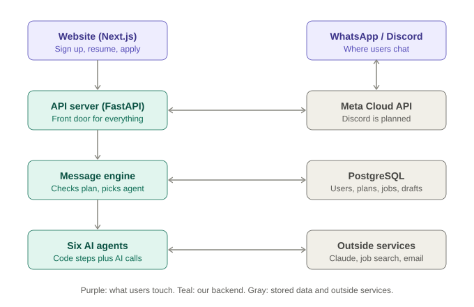

# JobsQ: architecture, tech stack and message flow

Status: v0.2 (2026-11-25). A plain-words summary of how JobsQ works. What is built today is listed in [CURRENT_BUILD.md](CURRENT_BUILD.md); the V1 design is in [BACKEND.md](BACKEND.md). The trial bot used earlier in testing was a separate, simpler program.

---

## 1. The system on one page

How to read it:
- **Purple** is what users touch: the website and WhatsApp (Discord is planned).
- **Teal** is our backend. The API server is the front door. Chat messages go to the message engine, which checks the user's plan and chooses the agent. The agents do the work.
- **Gray** is stored data and outside services: PostgreSQL, Meta's WhatsApp service, and the services the agents use (Claude, job search, email lookup). Payments are planned.

### How the AI is called

| Plan | How |
|---|---|
| **JobsQ AI** | JobsQ's **Claude API** key, paid per use by us. While developing without a key, our own connector runs the work with Claude Code on the developer's PC |
| **Your own AI** | The user runs the **JobsQ Connector** on their computer. It asks JobsQ for work, runs it with their own **Claude Code or Codex** subscription, and sends the answer back |

- **Code decides the flow, the model writes the words.** Searching, filtering, links, files, plan checks and the next step are ordinary code. The model is called only where judgment is needed: reading a resume, ranking jobs, research, writing.
- **Every call is measured** (time and tokens), so cost per user and per agent is known.
- In a side-by-side trial (10 runs each, judged blind), running Scout's search, Email's drafts and Prep's first answer as code plus one or two tool-free model calls kept their quality with far fewer tokens. Research, LinkedIn and Resume were weaker that way and stay full agents.

---

## 2. Tech stack

| Part | Built today | Planned |
|---|---|---|
| Website | Next.js (React) with TypeScript | Hosting (for example Vercel) |
| Backend API | Python 3.12 with FastAPI, in Docker | |
| Background work | Threads inside the API process | A queue and separate workers |
| Database | PostgreSQL 16 | Managed PostgreSQL, migrations, backups |
| WhatsApp | Meta's WhatsApp Cloud API (test number) | Production number |
| Discord | | Discord direct messages |
| AI | Claude API, or the user's Claude Code / Codex through the connector | |
| Resume files | pdfplumber and python-docx to read; Gotenberg prints the one-page PDF | Word output |
| Job data and contacts | JSearch and SerpApi for jobs; Hunter for contact emails; the user's LinkedIn connections file | |
| Payments | Test mode only | Razorpay or Stripe |

---

## 3. What happens when a user signs up

The website asks for the **resume** first. It is read with no AI and fills in the name, WhatsApp number, email, location and skills; the user corrects them and adds a password.

1. **Register.** The backend checks neither the email nor the phone number is used, stores only a password hash, and creates the user with no plan.
2. **Confirm email.** The link's one-time token is checked (emails appear on a dev inbox page for now).
3. **The resume is saved** with the new account and kept even though nothing is paid yet. (Without a file at sign-up, the start page asks for it.)
4. **Choose a plan** (JobsQ AI or Your own AI). Payment is test mode today. As soon as the plan starts, the AI reads the saved resume.
5. **Your own AI only:** make a connector key and start the connector.
6. **Optional:** connect WhatsApp (needs an active plan). The site shows a code and a chat link or QR code; the user sends the message from their phone, which links the number.
7. **Find me jobs.**

## 4. The order of work for a job

1. Scout shows jobs, best fit first; the user picks one.
2. The resume is tailored for it (one-page PDF).
3. The user applies on the company's site and presses **I've applied**.
4. Research finds people who can refer them: people they already know first, then others.
5. LinkedIn messages and referral emails are drafted. The user sends them.
6. The company replies: **I got a reply**, then interview prep.

Everything is a draft. Nothing is sent or applied for the user.

---

## 5. How the backend knows if a sender is registered and paid

The check runs on every incoming message.

1. Meta calls `POST /webhooks/whatsapp`. We check Meta's signature first.
2. We look up the sender's number. Unknown: "sign up first" (or link it, if the message has a link code).
3. The access level is worked out fresh each time:
   - **suspended:** the account is blocked.
   - **full:** a subscription is `active` or `past_due` and today is before the access end date.
   - **limited:** everything else.
4. Only `full` goes on. Others get one fixed reply and no agent runs.

Nothing stores "subscription ended", so it cannot go out of date. The website applies the same rule.

---

## 6. What happens when a paid member sends a WhatsApp message

1. **Gate checks:** the link is active (not stopped) and the daily message cap isn't passed. One user's messages are handled one at a time.
2. **Work out what they want**, cheapest and surest first:
   - a tapped button;
   - a reply to one of our messages (we know which job it was about);
   - a job code such as `A1 applied`;
   - a pattern such as `find jobs`, `go 1,3`, `jobs`, `status`, `stop`;
   - otherwise "I didn't catch that" with the menu.
3. **Choose the agent** in code from the words (resume, referral, LinkedIn, email, interview, research). No `@` is needed.
4. **Run and send.** The agent works in the background, saves its result, and replies in the chat, with the PDF attached for a tailored resume.

---

## 7. Job links with a picture card

WhatsApp builds the card from the job page's title and image. We turn link previews on and send each job as its own message, because WhatsApp previews only the first link. A site that publishes no title or image gets a plain link.
