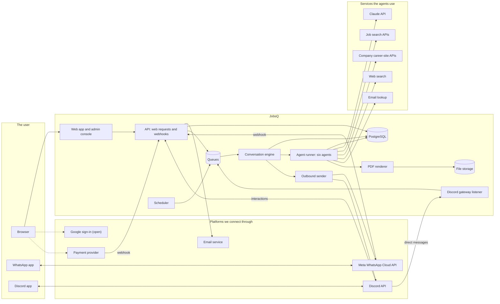
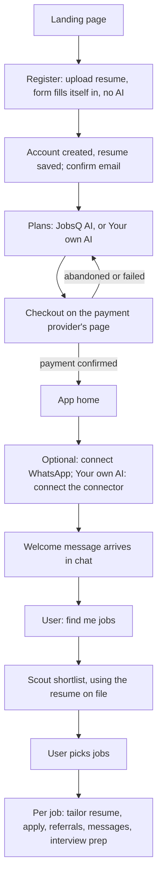
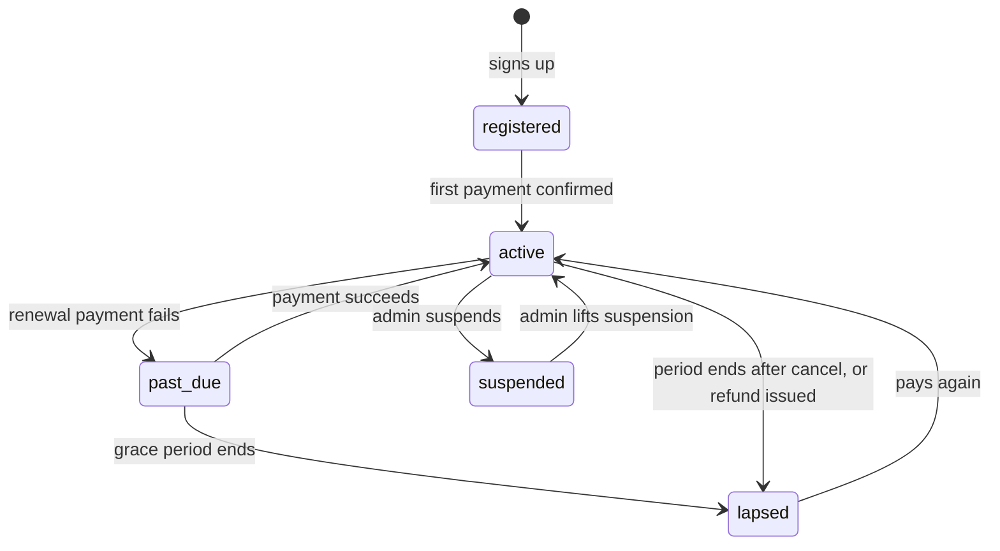
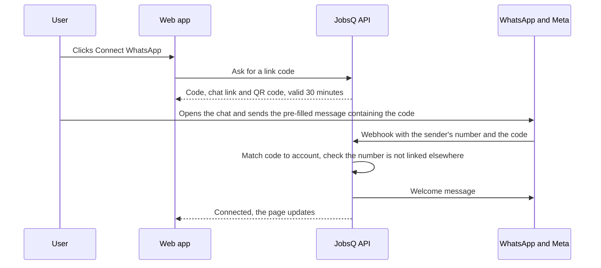
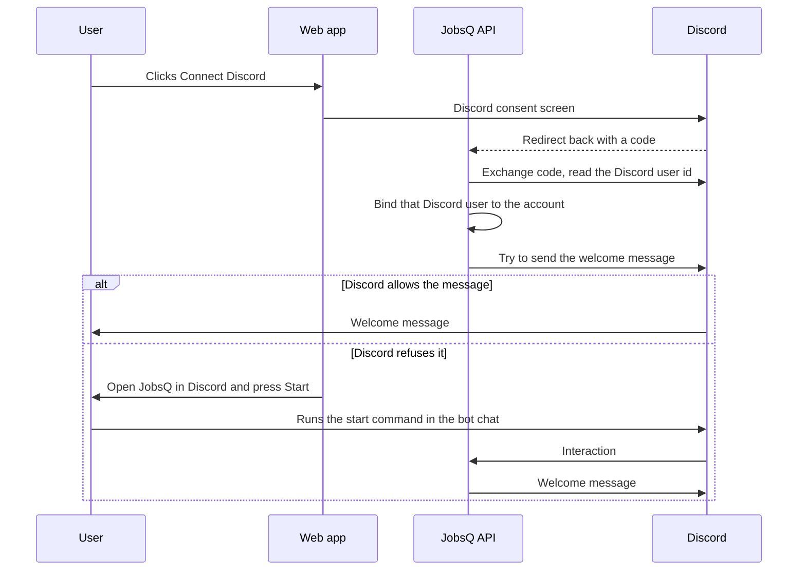
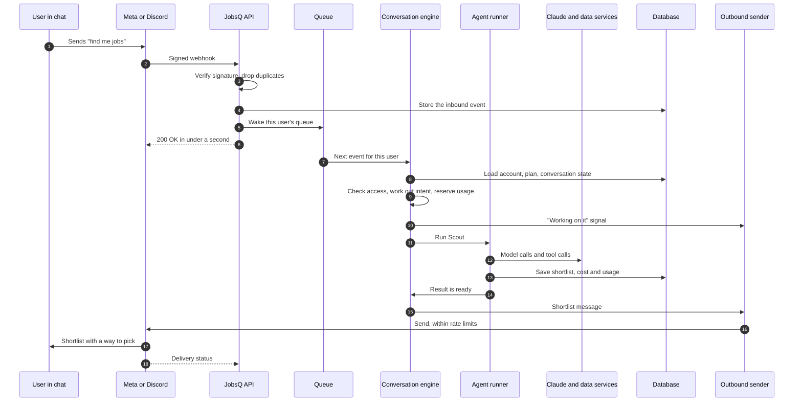
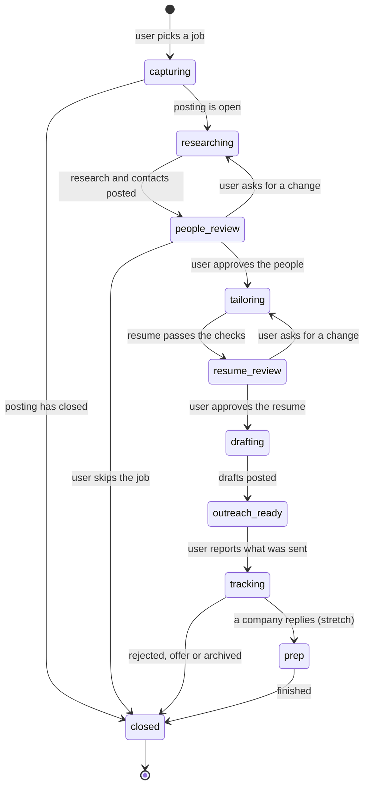
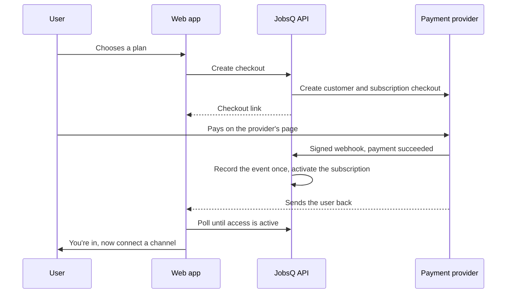

# JobsQ — How everything connects

> **What is built today** is in [CURRENT_BUILD.md](CURRENT_BUILD.md). This document describes the V1 target; parts not listed there are planned. Updated 2026-11-25 for the new plans, resume timing and order of work.

Status: Draft v0.3 (2026-11-25). Companion to the [PRD](PRD.md). The diagrams are Mermaid; they render on GitHub and in most Markdown viewers.

This document answers one question: **what talks to what, in what order, from sign-up to a sent referral email.** Detail for each part lives in the [backend design](BACKEND.md), the [feature docs](features/) and the [agent docs](agents/).

---

## 1. The short version

1. The user does these on the **web app**: registers (uploading their resume on the sign-up page), picks one of two plans (JobsQ AI, or Your own AI) and, if they like, connects WhatsApp.
2. From then on the user works **in the web app, in the chosen chat, or both**. The web app does everything the chat does. A message from chat reaches our **API** through Meta or Discord; a click in the web app reaches it directly.
3. The API only checks the message is genuine, stores it and puts it on a **queue**. It answers the platform in under a second.
4. The **conversation engine** takes the message off the queue, works out what the user wants, checks they are allowed (paid, not suspended, within limits) and decides the next step.
5. If the step needs an agent, the **agent runner** runs it. The AI call goes to the **Claude API** (JobsQ AI) or to the **JobsQ Connector** on the user's computer (Your own AI). Tools such as job search, email lookup and PDF rendering run on the server.
6. The result is saved in the **database**, then the **outbound sender** delivers it to the user's chat, at the speed the platform allows.
7. At each approval point the engine **stops and waits** for the user. Nothing is ever sent to a third party by JobsQ.

Everything behind the channel layer is the same for WhatsApp, Discord and the web app. Only the shape of the messages differs. A mobile app is planned on the same API.

---

## 2. System map

### 2.1 Every connection, one row each

| # | From | To | How | What travels | How we know it is genuine |
|---|---|---|---|---|---|
| 1 | Browser | Web app | HTTPS | Pages | TLS |
| 2 | Web app | API | HTTPS, JSON | Account, plans, dashboard data | Session cookie (server-side session) |
| 3 | Browser | Google (only if offered; open) | OpenID Connect redirect | Sign-in | Google signs the identity token; we verify it |
| 4 | Browser | Payment provider | Provider-hosted checkout page | Card or UPI details | These never reach JobsQ servers |
| 5 | Payment provider | API | Webhook (HTTPS POST) | Payment and subscription events | Signature header checked against a shared secret |
| 6 | API | Email service | HTTPS API | Verification and reset links, receipts, payment notices | API key |
| 7 | WhatsApp app | Meta | WhatsApp | The user's chat | Meta |
| 8 | Meta | API | Webhook (HTTPS POST) | Inbound messages, button taps, delivery statuses | `X-Hub-Signature-256` (HMAC with our app secret) |
| 9 | Outbound sender | Meta Cloud API | HTTPS | Text, buttons, lists, PDF documents, templates | System-user access token |
| 10 | Discord app | Discord | Discord | The user's chat | Discord |
| 11 | Discord | API | Interactions endpoint (HTTPS POST) | Slash commands, button taps, menus, forms | Ed25519 signature on every request |
| 12 | Discord | Gateway listener | WebSocket that we open | Typed direct messages and file uploads | Bot token |
| 13 | Outbound sender | Discord API | HTTPS | Messages, embeds, buttons, files | Bot token |
| 14 | API, gateway listener, scheduler | Queues | Redis (planned; not built yet) | "Process user X", "run agent", "send message" | Private network |
| 15 | Conversation engine, agent runner | PostgreSQL | SQL | All state | Database roles with row-level security |
| 16 | Agent runner | AI: the Claude API, or the user's JobsQ Connector | HTTPS (the connector only makes outgoing requests) | Prompts, resume and job text | JobsQ's API key (JobsQ AI) or the user's Claude Code / Codex login on their computer (Your own AI) |
| 17 | Agent runner | Job search APIs | HTTPS | Search queries (no personal data) | API keys |
| 18 | Agent runner | Company career-site APIs (Greenhouse, Lever, Ashby) | HTTPS | Posting lookups | Public endpoints |
| 19 | Agent runner | Web search | HTTPS | Company and people queries | API key |
| 20 | Agent runner | Email lookup | HTTPS | Company domain, contact name | API key |
| 21 | Agent runner | PDF renderer | Internal HTTP | Resume HTML | Private network |
| 22 | PDF renderer, API | File storage | S3 API | Resume files, exports | Access role; encrypted at rest |
| 23 | Admin console | Admin API | HTTPS | Account, billing and usage data | Company single sign-on plus role |

Rows 16 to 20 are the only places user data leaves JobsQ on the agents' behalf. Row 16 carries resume text, so the Claude API data-retention terms are part of the privacy review (see [BACKEND.md §18](BACKEND.md#18-security-and-privacy)).

---

## 3. The user's journey

Where the user lands after logging in depends only on what is missing:

| Missing | Lands on |
|---|---|
| A saved resume (not added at sign-up) | Start page, resume step |
| An active subscription | Plans screen |
| A running connector (Your own AI) | Connect-your-AI step |
| Nothing | Scout |

### 3.1 Account states

`suspended` is drawn as a state for readability. In the data it is a separate flag on the user, so a suspended user keeps their subscription record. The agents are on only when the user is not suspended **and** the subscription is `active` or `past_due`. That rule is computed on every request, never stored.

---

## 4. Connecting a channel

### 4.1 WhatsApp

The user sends the first message, so this needs no paid template and no typed phone number. It also opens the 24-hour window in which we can reply freely.

### 4.2 Discord

Whether a bot may message a user first when the app is installed only to their account is **not confirmed** in Discord's documentation. Both branches are built; a 30-minute test in week 1 tells us which one users will see ([06-discord-channel.md](features/06-discord-channel.md)).

### 4.3 No switching, and the web app

There is no switching. After the user has chosen WhatsApp or Discord, the other one is refused. If the chosen channel stops working, the user carries on in the web app, which does everything the chat does, and reconnects the same channel later. Every approval and prompt exists in both places, and the first answer wins.

**One history.** The web app and the chosen chat share one timeline per user. Each message, card and answer is one record with the place it came from. A prompt, follow-up or approval is created once, shown in the web app always and in the chat when the channel allows it. The first answer wins and a late tap gets "already done". Old buttons carry the item's version. If the user only uses the web app and the WhatsApp window is closed, the prompt waits in the web app. Table of edge cases: [RECOMMENDATIONS §5](archive/RECOMMENDATIONS_2026-11-18.md#5-same-history-on-the-web-and-in-the-chat).

**Copy button.** Email and LinkedIn drafts arrive with a copy button: a real one in the web app; on WhatsApp and Discord a text-only message (Discord: in a code block) plus a "send as plain text" button, until the week-1 test confirms what each platform allows.

**Scale.** The system is built for 100 to 1,000 users at once; the same flows run behind queues and workers, and webhooks are answered within a second ([PRD 9a](PRD.md#9a-scale-and-production-readiness)).

---

## 5. One message, there and back

Four rules hold this together:

1. **Fast acknowledgement.** The API does no agent work. It verifies, stores, queues and returns.
2. **One user, one thing at a time.** Events for the same user are processed in order, under a per-user lock. Different users run in parallel.
3. **Safe to repeat.** Platforms resend webhooks. Each inbound event and each approval is processed once, keyed on the platform's own id.
4. **Outbound is a separate lane.** Agents never call WhatsApp or Discord. They return a channel-neutral message; the sender renders it for the user's channel and respects rate limits and the WhatsApp 24-hour window.

Typed Discord direct messages enter at step 2 through the gateway listener, not a webhook. Everything after step 4 is identical.

---

## 6. Working one job

| Step | Who works | What the user gets | Who decides | Saved | Usage counted |
|---|---|---|---|---|---|
| Shortlist | Scout | Up to 10 recent jobs, a reason each and no score | **User picks** (approval 1) | Shortlist and its items | 1 shortlist |
| Capture | Scout | "Company – Role" confirmation | — | Job text, pipeline, short code such as J7 | — |
| Research | Researcher | Company summary, 2 to 3 possible referrers | **User approves people** (approval 2) | Research, contacts | 1 application, when research is delivered |
| Resume | Resume Tailor | One-page resume (PDF and Word), what changed, gaps | **User approves resume** (approval 3) | Resume JSON, PDF, check results | — (revisions are capped) |
| Outreach | Email and LinkedIn agents | One email draft and one LinkedIn note per person | **User sends** (approval 4) | Drafts, short links | — |
| Tracking | Engine | Updated status | User reports | Sent, replied, application status | — |
| Prep (stretch) | Interview Prep | Guide and mock interview | User | Prep guide | 1 prep session |

Several jobs can be in progress at once. Each message about a job starts with its code and "Company – Role", and every button carries the job with it, so a tap can never land on the wrong job.

---

## 7. Payment and access

The webhook, not the redirect, is what grants access. If the user closes the tab after paying, access still turns on. If the webhook is late, the page shows "confirming payment" and keeps checking.

---

## 8. What runs on a timer

| Job | How often | What it does |
|---|---|---|
| Stuck-run sweeper | Every 5 minutes | Fails agent runs that passed their time limit, releases the reserved usage, tells the user |
| Outbox relay | Every few seconds | Queues any message or agent run that was saved but not queued (crash safety) |
| Grace-period expiry | Hourly | Moves `past_due` subscriptions to lapsed when the grace period ends |
| WhatsApp health check | Hourly | Reads the number's quality rating and messaging limit, alerts on a drop |
| Subscription reconcile | Daily | Compares our subscription records with the payment provider's |
| Message-body purge | Daily | Removes stored chat text older than the retention period |
| Prompts due | Hourly | Finds the "Did you apply?" (2 hours after the resume is approved) and "Did you get a reply?" (4 days after Yes, repeated for 30 days) prompts that are due, and sends one message per user per day. The day counts are working values |
| Erasure purge (later) | Daily | Not in V1. Completes self-service deletions once the button is built. Until then the super admin runs the erasure procedure by hand |
| Follow-up drafts to contacts (stretch) | Hourly | Prepares follow-up drafts |
| Daily digest (stretch) | Every 15 minutes | Sends the digest to users whose chosen local time has arrived |

---

## 9. When something fails

| Failure | What the user sees | What the system does |
|---|---|---|
| Claude API slow or down | "This is taking longer than usual" then, if it still fails, a clear message | Retries with back-off, releases the reserved usage, raises an alert |
| Job search provider down | Shortlist from the other provider, or a plain "couldn't search right now" | Falls back to the second provider; cached results are used if fresh |
| Tailored resume fails the truthfulness check | Nothing until a version passes; after 2 retries, an explanation | Regenerates with the list of failures; never shows a failed version |
| Resume will not fit one page | A message naming what to cut | Trims and retries up to 3 times |
| WhatsApp result ready after the 24-hour window | An approved notification, then the result when they reply | Holds the result; it is always visible on the dashboard |
| Discord refuses a message | A banner on the web app | Marks the channel unreachable after repeated failures |
| Payment webhook delayed | "Confirming payment" | Polls; reconcile job repairs any miss |
| Plan limit reached | Which limit, the reset date, an upgrade link | Stops before the step starts, counts nothing |
| An agent is switched off by an admin | "Temporarily unavailable, your job is saved" | Parks the pipeline, resumes it when the agent is back |
| Our worker crashes mid-step | Possibly a short delay | The step is retried under the same idempotency key, so nothing is done twice |

---

## 10. Where each part is specified

| Part | Document |
|---|---|
| Sign-up and login | [features/01-registration-and-login.md](features/01-registration-and-login.md) |
| Plans, checkout, renewals, refunds | [features/02-subscriptions-and-billing.md](features/02-subscriptions-and-billing.md) |
| Plan limits | [features/03-usage-limits.md](features/03-usage-limits.md) |
| Choose, connect, reconnect, disconnect | [features/04-channel-connection.md](features/04-channel-connection.md) |
| WhatsApp messages and rules | [features/05-whatsapp-channel.md](features/05-whatsapp-channel.md) |
| Discord messages and rules | [features/06-discord-channel.md](features/06-discord-channel.md) |
| Routing, approvals, the job pipeline | [features/07-conversation-engine.md](features/07-conversation-engine.md) |
| Resume upload and profile | [features/08-resume-and-profile.md](features/08-resume-and-profile.md) |
| Tracker | [features/09-tracker.md](features/09-tracker.md) |
| Web dashboard | [features/10-web-dashboard.md](features/10-web-dashboard.md) |
| Admin console | [features/11-admin-console.md](features/11-admin-console.md) |
| Export and erasure on request | [features/12-data-export-and-deletion.md](features/12-data-export-and-deletion.md) |
| Follow-ups, daily digest (stretch) | [features/13-follow-ups.md](features/13-follow-ups.md), [features/14-daily-digest.md](features/14-daily-digest.md) |
| The six agents | [agents/](agents/) |
| Services, database, API, queues | [BACKEND.md](BACKEND.md) |
| WhatsApp approval track | [WHATSAPP_VERIFICATION_PLAN.md](WHATSAPP_VERIFICATION_PLAN.md) |
