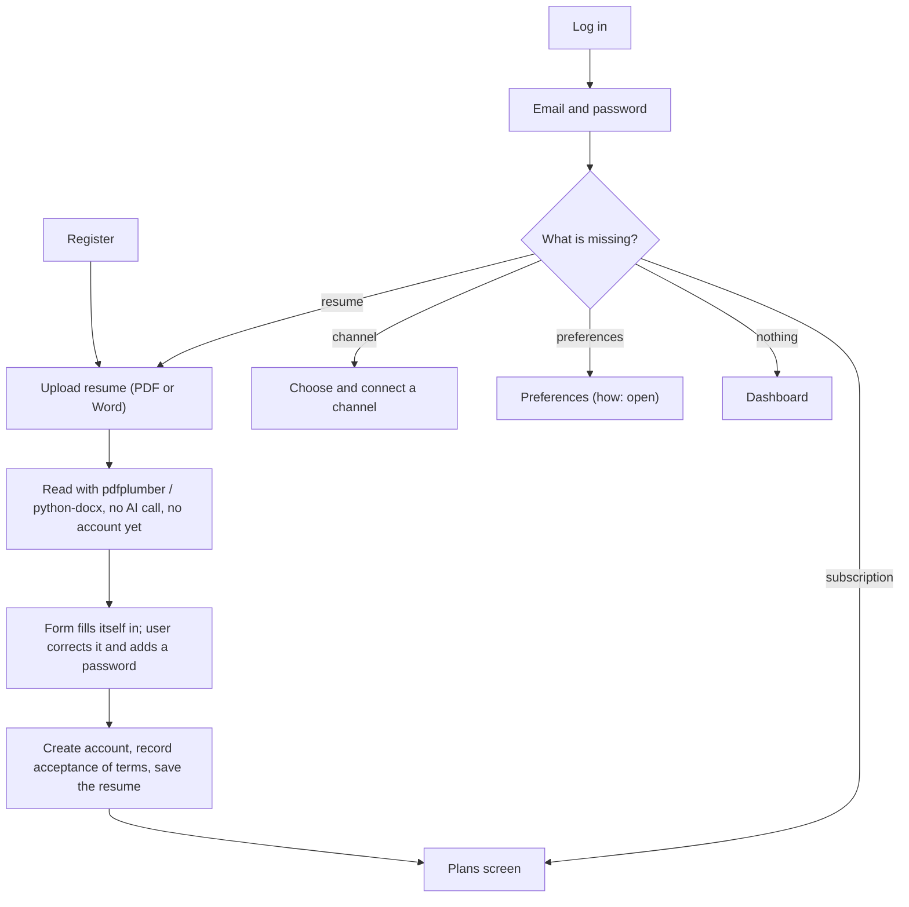

# 01 — Registration and login

> **What is built today** is in [CURRENT_BUILD.md](../CURRENT_BUILD.md). This document describes the V1 target; parts not listed there are planned. Updated 2026-11-25 for the new plans, resume timing and order of work.

| | |
|---|---|
| Status | Draft v0.2 (2026-11-18) |
| Scope | Must have (V1) |
| PRD | §5 Account and subscription · §6 items 1, 2, 4 · §7.1 · §7.2 |
| Backend | [BACKEND.md](../BACKEND.md) §7, §8.3, §9.2 |
| Depends on | An email sending service |
| Decisions | [DECISIONS_2026-11-18.md](../archive/DECISIONS_2026-11-18.md) D7, D8, D9, D10 |

## 1. Purpose

Let a visitor create an account in a few seconds with only the essentials, add a resume, and reach the plans screen. Let a returning user get back in, whatever state their account is in. **Passwords are stored** (decided 18 Nov 2026), so this document also sets the rules for storing and resetting them.

## 2. Flow

Registration is deliberately short. **Job preferences and other details are not asked here.** How and when they are collected is open ([PRD §10](../PRD.md#10-open-questions), question 10).

## 3. Rules

1. **Email and password.** The password is stored only as a salted hash (Argon2id, or the CTO's alternative). It is never logged, never emailed and never shown. Whether Google sign-in is also offered is open (PRD question 29).
2. **The account needs: full name, phone number, email, password.** The first three are filled in from the resume where found. The resume's location, years and skills are saved with it.
3. **One person, one account.** The same email, or the same phone number, cannot register twice. The second attempt is told to log in or reset the password.
4. **Email is verified** by a link sent after registration. An unverified email cannot receive payment receipts or reset links, and the user is asked to verify before paying.
5. **The phone number is stored at registration.** It is verified when WhatsApp is chosen (a code sent on WhatsApp). Whether it is verified earlier is open (PRD question 29).
6. **Password rules:** at least 10 characters; checked against a list of common passwords; no composition rules beyond that. A strength hint is shown.
7. **Login limits:** 5 wrong passwords in 15 minutes lock that account's login for 15 minutes and send an email notice. Limits per IP address as well.
8. **The response never reveals whether an email is registered**, on login and on reset. The screen always says "If that address has an account, an email is on its way" or "Email or password is wrong".
9. **Reset:** an emailed link, valid 30 minutes, usable once. Using it ends all other sessions.
10. **Sessions** last 30 days from last use. A user can see their sessions and end any or all of them.
11. **Anyone with an account can log in**, including unpaid, lapsed and suspended users. What they can reach is decided by access level ([BACKEND.md §7.2](../BACKEND.md#72-access-level-computed-on-every-request-and-every-inbound-message)).
12. **Terms and privacy policy are accepted at registration**, and the version accepted is recorded.
13. **The resume is collected on the registration screen** (a user without the file can type the fields and add it right after) and confirmed before the user can continue to plans ([08-resume-and-profile.md](08-resume-and-profile.md)).
14. **Staff log in the same way.** Admin roles are extra permissions on an account, and staff accounts also require a second factor (proposed).

## 4. Registration fields

| Field | Required | Rules |
|---|---|---|
| Full name | Yes | 2 to 80 characters. Used on the tailored resume header and email sign-offs |
| Phone number | Yes | International format with country code (default +91). Unique across accounts |
| Email | Yes | Unique. Verified by link |
| Password | Yes | Rule 6 |
| Terms and privacy | Yes | Tick box, version recorded |

Not collected here: country, timezone, roles, skills, locations, work mode, experience, salary, industries, excluded companies. Their collection is open. Until it is settled, the timezone is taken from the browser and the country is taken from the phone number prefix.

## 5. The resume step

The registration screen starts with a PDF or Word upload. The file is read with pdfplumber (PDF) and python-docx (Word) into the form, with **no AI model call** and nothing stored; it is saved when the account is created, before payment. This reading needs no account, so it is size and rate limited. Full rules in [08](08-resume-and-profile.md).

## 6. Functional requirements

| ID | The system shall… | Priority | Acceptance |
|---|---|---|---|
| AUTH-01 | register a user with name, phone, email and password | Must | The four fields are validated; a duplicate email or phone is refused |
| AUTH-02 | log a user in with email and password | Must | A correct pair starts a session; a wrong pair gives the generic message |
| AUTH-03 | store passwords only as salted hashes | Must | No plain or reversibly encrypted password exists in the database, logs or backups |
| AUTH-04 | verify the email by a link | Must | An unverified user cannot pay; the link works once and expires |
| AUTH-05 | record acceptance of the terms and privacy policy, with version and time | Must | A `consents` row exists for every user before registration completes |
| AUTH-06 | limit login attempts and reset requests | Must | The limits in rule 7 hold under test; the response is the same whether limited or not, apart from a "try again later" notice |
| AUTH-07 | never reveal whether an email is registered | Must | Responses and timing are indistinguishable for known and unknown addresses |
| AUTH-08 | keep a session for 30 days from last use and let the user end it | Must | Logout ends the session at once; "log out everywhere" ends all of them |
| AUTH-09 | let the user reset a forgotten password by emailed link | Must | Link valid 30 minutes, single use; other sessions end |
| AUTH-10 | let a logged-in user change the password | Must | Needs the current password; other sessions end |
| AUTH-11 | collect a confirmed resume before plans | Must | `registered_at` is set at registration; the user reaches plans only when a resume is `confirmed` |
| AUTH-12 | send a signed-in user to the first missing step | Must | Each case in the flow diagram lands on the stated screen |
| AUTH-13 | require confirmation that the user is 18 or older | Should | Pending legal review |
| AUTH-14 | show the user their active sessions | Should | List with device, approximate location and last use |
| AUTH-15 | check new passwords against a list of known leaked or common passwords | Should | A listed password is refused |

## 7. Screens

| Screen | Content |
|---|---|
| Register | Resume upload that fills in the form; name, phone, email, password, terms tick box. One screen |
| Log in | Email, password, "Forgot password" |
| Reset | Email field; then the new-password page from the link |
| Resume | Upload box; after reading, the extracted text and summary with "Looks right" and "Fix something". "Continue to plans" is enabled only once the resume is confirmed |
| Sessions (in Account) | List of sessions; "Log out" per row; "Log out everywhere" |

All screens work on a phone. Accessibility target: WCAG 2.1 AA.

## 8. Data and API

Tables: `users` (with `password_hash`), `password_resets`, `email_verifications`, `sessions`, `consents` ([BACKEND.md §8.3](../BACKEND.md#83-identity)). `preferences` is filled by the preferences step, not by registration.

Routes: `/v1/auth/*`, `/v1/me`, `/v1/me/sessions` ([BACKEND.md §9.2](../BACKEND.md#92-account)).

## 9. Edge cases and errors

| Case | Behaviour |
|---|---|
| Verification email does not arrive | "Send again" after 60 seconds; suggest checking spam |
| Typo in the email address | The user cannot verify; they correct the email (needs the password) before paying |
| Phone number already used | Refused with "log in or reset your password" |
| Wrong password many times | Lock and notice (rule 7) |
| User forgets the password | Reset by link |
| Session cookie stolen | "Log out everywhere" ends it; sessions record IP address and browser |
| User abandons after registering | Account exists; next login returns to the first missing step |
| Phone number changes | Changing it later needs the password and, once WhatsApp is chosen, a new WhatsApp verification **[TBD]** |
| Suspended user logs in | Session starts; they see the suspension notice with billing and export |
| Breach of the password table | Hashes only are exposed; see section 10 |

## 10. Security

- Password hashing: Argon2id with a per-user salt and a server-side pepper held outside the database. Parameters are set by the CTO and reviewed yearly.
- Passwords never appear in logs, error reports, analytics or admin screens. The register and login request bodies are redacted from request logs.
- The session token is random and long; only its hash is stored. The cookie is `HttpOnly`, `Secure`, `SameSite=Lax`. The session id changes at login. State-changing requests carry a CSRF token.
- Reset tokens and verification tokens are stored hashed and compared in constant time.
- Sign-in events are logged with user id and result, never with the password.
- Because passwords are stored, a security review of this feature is required before launch.

## 11. Not in V1

Sign-in with Apple, LinkedIn or GitHub; changing the account's email address; team or shared accounts; two-factor authentication for ordinary users (proposed for staff).

## 12. Open questions

| # | Question | Owner |
|---|---|---|
| 1 | How and when are job preferences collected, and what are the fields? (PRD question 10) | Product owner |
| 2 | Is Google sign-in offered next to email and password? Is the phone verified at registration or at WhatsApp connection? (PRD question 29) | Product owner |
| 2a | **The user's LinkedIn ID:** collect it or not, when (not at registration), whether it is required, what it is used for, and how it is erased on request (PRD question 32) | Product owner |
| 3 | Session length: 30 days proposed | CTO |
| 4 | Is an age confirmation required by Indian law? | Legal |
| 5 | Is a second factor required for staff accounts? | CTO |
