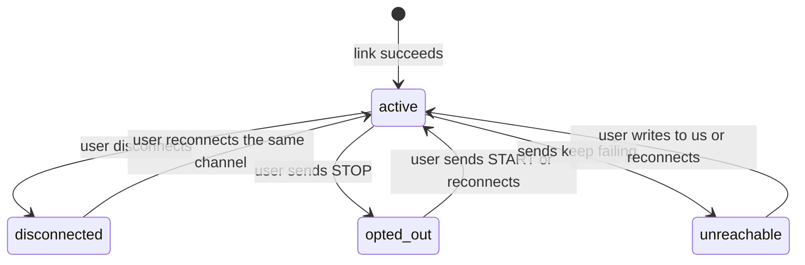

# 04 — Channel connection

> **What is built today** is in [CURRENT_BUILD.md](../CURRENT_BUILD.md). This document describes the V1 target; parts not listed there are planned. Updated 2026-11-25 for the new plans, resume timing and order of work.

| | |
|---|---|
| Status | Draft v0.2 (2026-11-18) |
| Scope | Must have (V1) |
| PRD | §5 Connecting a channel · §6 items 5, 6 · §7.4 · §8 Channels |
| Backend | [BACKEND.md](../BACKEND.md) §8.5, §9.4, §15 |
| Depends on | [05-whatsapp-channel.md](05-whatsapp-channel.md), [06-discord-channel.md](06-discord-channel.md), a registered account |

## 1. Purpose

The user can **choose one** chat channel, WhatsApp or Discord, and link it from the web app **after subscribing**; it is optional. **Both options are in the plan. The choice is made once and there is no switching** (decided 18 Nov 2026). The web app itself is a third way into the same engine and does everything the chat channel does, so a user is never blocked if the chat channel has a problem.

## 2. Rules

1. Only a user with full access (an active plan) can connect a channel.
2. **One chosen channel per user, for good.** The database enforces it. The user can disconnect it, but cannot replace it with the other one.
3. **One account per chat identity.** A WhatsApp number or a Discord account can be linked to only one JobsQ account at a time.
4. Linking always proves two things at once: the person controls the web account (they are logged in) and controls the chat identity (the link step happens from inside that chat app).
5. **Everything in chat is also in the web app.** Shortlists, approvals, drafts, the tracker and the timed prompts all appear in the web workspace too ([10](10-web-dashboard.md)). An approval given in one place is final in the other.
6. **Reconnecting the same channel is allowed** (after STOP, a block, a deleted chat, or a new phone number). Connecting the other channel is refused, with an explanation.
7. A user may choose to use the web app only and never connect a chat channel. Nothing requires a connection. The reminders then appear in the web app and by email.
8. Losing access (lapsed, suspended) does **not** unlink the channel. The agents stop; the link stays so that paying again restores everything.
9. Jobs, approvals and files belong to the account, not the channel.

## 3. Connecting WhatsApp

1. The user clicks **Connect WhatsApp**.
2. We create a one-time link code, valid for 30 minutes, and show:
   - on a phone, a button that opens WhatsApp with the message already typed;
   - on a computer, a QR code for the phone camera and the same button for WhatsApp desktop.
3. The typed message reads: `Connect my JobsQ account: JQ-XXXXXX`
4. The user presses send. Meta delivers the message to us with the sender's number.
5. We find the code in the text, check it is unused and unexpired, check the number is not linked to another account, and create the link.
6. The welcome message arrives in WhatsApp; the web page updates by itself.

Why this way: the user sends the first message, so we need no paid authentication template, the user never types a phone number, and the 24-hour reply window opens immediately. Sending the message is also the user's opt-in to receive replies there, and the screen says so.

## 4. Connecting Discord

1. The user clicks **Connect Discord**.
2. They see Discord's consent screen, which asks to share their Discord identity and to add the JobsQ app to their account.
3. Discord returns them to us. We read their Discord user id and create the link.
4. We try to send the welcome message.
   - If Discord accepts it, the user finds it in their direct messages.
   - If Discord refuses, the web page shows **Open JobsQ in Discord** and asks the user to press Start there. That interaction lets us reply.
5. The web page updates by itself.

Whether step 4's first branch works for an app installed only to a user's account is unconfirmed; see [06-discord-channel.md §10](06-discord-channel.md#10-open-questions). Both branches are built.

**Fallback code.** If the browser and the Discord app are signed in to different Discord accounts, the consent screen links the wrong one. The Connect screen therefore also offers "Use a code instead": we show a code and the user runs `/link` with it inside Discord. The account that types the code is the one linked.

## 5. No switching

There is no switch. Once the user has chosen WhatsApp or Discord, the other one is not offered, and the API refuses to link it.

1. If a user who chose one channel asks for the other, the web app says: "JobsQ works through one chat channel. Yours is WhatsApp. You can also do everything in the web app."
2. Whether a one-off exception is possible (for example a user who lost their WhatsApp number for good) is handled by support by hand, and is an open question below.
3. If the chosen channel stops working, the user keeps working in the web app and reconnects the same channel when they can.

## 6. Disconnecting and opting out

| Action | Result |
|---|---|
| **Disconnect** on the web | Link becomes `disconnected`. Agents idle. Jobs kept. The dashboard prompts to connect a channel |
| User sends **STOP** on WhatsApp | Link becomes `opted_out`. We send one confirmation, then nothing. **START**, or reconnecting from the web, resumes |
| User blocks the bot or removes the app on Discord | Our sends fail. After repeated failures the link becomes `unreachable` and the web app shows a banner with "Reconnect" |
| Account erased on request | The channel link is erased with the other personal data ([12](12-data-export-and-deletion.md)); the activity log keeps only the user ID |

## 7. Messages from people we do not know

A WhatsApp message or Discord interaction from an identity with no active link gets **one** reply: "This chat isn't connected to a JobsQ account yet. Sign up or connect here: [link]". At most one such reply per sender per 24 hours. No agent runs and no model is called.

## 8. Link states

## 9. Functional requirements

| ID | The system shall… | Priority | Acceptance |
|---|---|---|---|
| CHAN-01 | allow connecting only with full access | Must | A limited or suspended user cannot make a code, and a code sent after the plan ended does not link |
| CHAN-02 | allow one chosen channel per user | Must | Enforced by a unique index; a second active link, or a link to the other channel after one was chosen, cannot be written |
| CHAN-03 | link WhatsApp by a one-time code the user sends from WhatsApp | Must | A valid code links the sender's number; an expired, used or unknown code does not |
| CHAN-04 | link Discord by Discord's consent screen | Must | The Discord user id from Discord is linked; the `state` value is checked |
| CHAN-05 | offer a typed-code fallback for Discord | Should | `/link CODE` links the account that ran it |
| CHAN-06 | refuse a chat identity already linked to another account | Must | The user is told in chat and on the web; the other account is not revealed |
| CHAN-07 | send a welcome message when a link succeeds | Must | Arrives within 5 seconds, or the Discord fallback screen is shown |
| CHAN-08 | update the web page without a manual refresh when the link completes | Must | The Connect screen changes to "Connected" within 3 seconds |
| CHAN-09 | refuse to link the other channel once one has been chosen | Must | The API returns a clear refusal; the web app shows the explanation in section 5 |
| CHAN-10 | allow reconnecting the same channel | Must | After STOP, a block or a new phone number, the same channel can be linked again |
| CHAN-11 | keep every approval available in the web app and in the chosen channel | Must | An approval pending in chat can be answered on the web, and the chat button then says "already done" |
| CHAN-18 | work without any chat channel | Must | A user who never connects a channel can run the whole flow in the web app |
| CHAN-12 | let the user disconnect from the web | Must | No further messages are sent to that chat |
| CHAN-13 | honour STOP at once and START to resume | Must | After STOP, zero outbound messages apart from the confirmation |
| CHAN-14 | reply to an unknown sender at most once per 24 hours | Must | Ten messages from an unknown number produce one reply |
| CHAN-15 | limit link attempts | Must | At most 5 codes per user per hour |
| CHAN-16 | show the channel's state on the web | Must | Connected, opted out and unreachable each show a distinct message |
| CHAN-17 | keep the link when access is lost | Must | A user who lapses and renews needs no reconnect |

## 10. Screens and messages

| Screen | Content |
|---|---|
| Choose | Two cards, WhatsApp and Discord, each with what the user will be asked to do and a button. A line: "Pick the one you use most. You can't switch later, and the web app does everything too." A third link: "Use the web app only for now" |
| WhatsApp step | QR code, "Open WhatsApp" button, the code in text, a 10-minute countdown, "Get a new code" |
| Discord step | "Continue to Discord" button; after return: "Check your Discord messages" or "Open JobsQ in Discord and press Start"; "Use a code instead" |
| Channel (connected) | Channel name and masked handle, connected date, status, "Disconnect" and "Reconnect" |

Welcome message (both channels, wording to be finalised):

> You're connected to JobsQ. I'm your job-hunt team: Scout, Researcher, Resume Tailor, Email and LinkedIn. Nothing is ever sent for you — you approve every step.
> Say **find me jobs** to start, or send me a job link.

Buttons: **Find me jobs** · **How it works**

## 11. Data and API

Tables: `channel_links`, `channel_link_codes`, `consents` ([BACKEND.md §8.5](../BACKEND.md#85-channels-and-conversation)).

Routes: `/v1/channels/*` ([BACKEND.md §9.4](../BACKEND.md#94-channels)).

Codes: 8 characters from an alphabet without look-alike letters, shown as `JQ-XXXX-XXXX`; stored hashed; single use; 10 minutes.

## 12. Edge cases

| Case | Behaviour |
|---|---|
| User edits the pre-filled WhatsApp message | We search the text for the code pattern; any message containing a valid code works |
| Code sent from a number linked to another account | Refused in chat; the web shows "That number is connected to a different account" |
| Code expires before sending | Chat reply: "That code has expired. Get a new one on the Connect page" |
| User starts linking both channels at once | Whichever completes first wins; the other code is cancelled |
| User tries to link the other channel | Refused (section 5) |
| Chat channel down or blocked while an approval waits | The approval is answered in the web app |
| WhatsApp number changed by the user | To us it is a new number: reconnect WhatsApp with the new number; the old link becomes unreachable. This is not a switch |
| Discord account deleted | Sends fail; link becomes `unreachable` |

## 13. Open questions

| # | Question | Owner |
|---|---|---|
| 1 | Can the Discord bot send the first message to a user who installed the app to their account only? (Week-1 test) | CTO |
| 2 | Is there ever an exception to "no switching" (a lost number, a closed Discord account)? Proposed: support handles it by hand, no self-service | Product owner |
| 3 | Should the WhatsApp number be verified at registration or only here? (PRD question 29) | Product owner |
